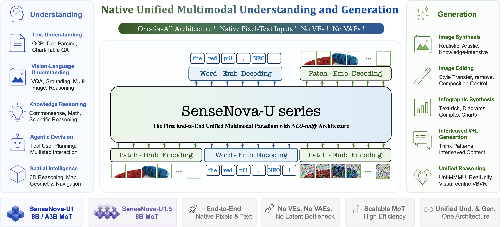
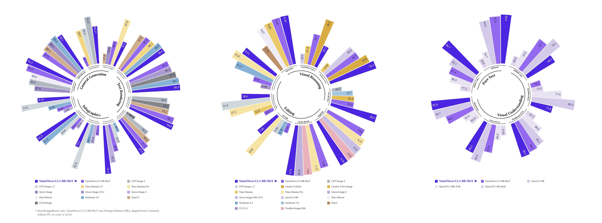
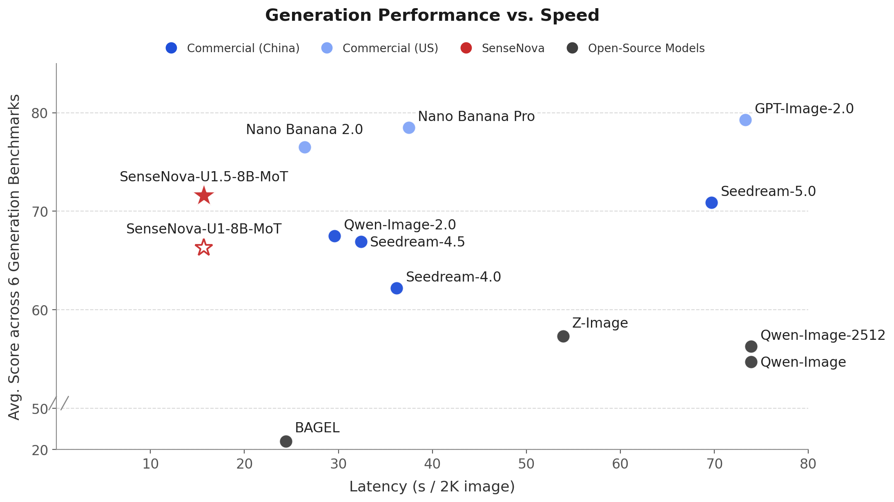
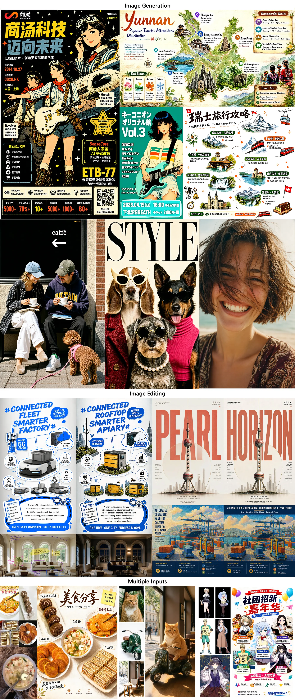

# SenseNova-U: Native multimodal understanding and generation

<strong>English</strong> | <a href="./README_CN.md">简体中文</a>

  
  
  
  
  
  
  
  
  

## Overview

SenseNova-U is a family of native multimodal models built on [NEO-unify](https://huggingface.co/blog/sensenova/neo-unify). The same model can understand an image, generate or edit one, and produce responses that alternate between text and images. [U1](https://arxiv.org/abs/2605.12500) introduced this approach; [U1.5](https://arxiv.org/abs/2609.11929) develops it further with an 8B-MoT model, an encoder-free and VAE-free visual path, and spatially coherent image reconstruction.

**U1.5** focuses on four practical areas:

- **Image generation:** native resolutions up to 4K, with improved composition, local detail, and material rendering.
- **Text and layout:** clearer Chinese and English text in posters, infographics, and other structured images.
- **Image editing:** local and multi-reference changes that better preserve subject identity and untouched regions.
- **Understanding and interleaving:** visual question answering and illustrated responses with text and images in sequence.

This repository contains the inference examples, training code, and documentation for U1 and U1.5. The [U1.5 guide](docs/u1.5_model.md) covers the current checkpoint and its limitations; the [showcases](docs/u1.5_showcases.md) collect generation and editing examples.

## News

- **2026-11-04:** Released [U1.5 TailSteer](https://huggingface.co/sensenova/SenseNova-U1.5-8B-MoT-TailSteer), a full checkpoint for more stable multi-turn image editing. Use it with the existing editing script by changing the model path.
- **2026-09-24:** Released the [U1.5 8-step V2 LoRA](https://huggingface.co/sensenova/SenseNova-U1.5-8B-MoT-LoRAs/blob/main/SenseNova-U1.5-8B-MoT-LoRA-8step-V2.safetensors). Compared with the first 8-step adapter, it improves color balance and contrast while reducing oversharpening. It runs with the U1.5 base model.
- **2026-09-11:** Published the [U1.5 technical report](docs/pdf/SenseNOVA_U1_5.pdf), covering the architecture, training approach, and evaluations.
- **2026-08-20:** Released [U1.5](https://huggingface.co/sensenova/SenseNova-U1.5-8B-MoT) and the [first 8-step LoRA](https://huggingface.co/sensenova/SenseNova-U1.5-8B-MoT-LoRAs/blob/main/SenseNova-U1.5-8B-MoT-LoRA-8step.safetensors). U1.5 improves instruction following, text and layout, native 4K generation, and image editing over Preview.
- **2026-07-31:** Released [U1.5 Preview](docs/u1.5_preview.md), with a focus on native 4K generation, local texture, complex layouts, and preserving subjects during editing.
- **2026-07-16:** Released [U1 Infographic V3](docs/u1_infographic_model.md), bringing infographic generation and editing into one checkpoint, including local text changes and broader style or layout edits.
- **2026-06-29:** Released [U1 Infographic V2](docs/u1_infographic_model.md), improving dense text, complex layouts, and overall visual consistency.
- **2026-06-11:** Released [U1 Interleaved](https://huggingface.co/sensenova/SenseNova-U1-8B-MoT-Interleaved) for multi-page text-image generation, with improvements to narrative, character, and style consistency.
- **2026-05-21:** Published [U1 full-parameter training code](training/README.md).

## U1.5 weights

Other releases and community integrations are listed in the [model catalog](docs/models.md).

| Weight | Type | Tasks | Documentation |
| --- | --- | --- | --- |
| [SenseNova-U1.5-8B-MoT](https://huggingface.co/sensenova/SenseNova-U1.5-8B-MoT) | Full checkpoint | Image generation, editing, interleaved output, visual Q&A | [Guide](docs/u1.5_model.md) · [Showcase](docs/u1.5_showcases.md) |
| [SenseNova-U1.5-8B-MoT-LoRA-8step-V2](https://huggingface.co/sensenova/SenseNova-U1.5-8B-MoT-LoRAs/blob/main/SenseNova-U1.5-8B-MoT-LoRA-8step-V2.safetensors) | LoRA adapter; requires U1.5 | 8-step image generation, editing, interleaved output | [LoRA setup](docs/u1.5_model.md#8-step-v2-lora) |

## Quick start

Use a mostly idle Linux machine with one CUDA GPU. Plan for **24 GB of GPU memory and 64 GB of system RAM**, plus about **35 GB of disk space** for the U1.5 weights. Install [uv](https://docs.astral.sh/uv/getting-started/installation/) first; the commands use Python 3.11 and the `balanced` memory mode.

~~~bash
git clone --depth 1 https://github.com/OpenSenseNova/SenseNova-U1.git
cd SenseNova-U1
uv sync --locked --python 3.11
source .venv/bin/activate

hf download sensenova/SenseNova-U1.5-8B-MoT \
  --local-dir ./models/SenseNova-U1.5-8B-MoT

python examples/t2i/inference.py \
  --model_path ./models/SenseNova-U1.5-8B-MoT \
  --prompt "A cinematic mountain lake at sunrise, realistic photography." \
  --width 2048 --height 2048 --num_steps 50 \
  --vram_mode balanced --attn_backend sdpa \
  --output output.png
~~~

`balanced` uses system RAM. Process CPU RSS peaked around 52.2 GiB in the RTX 5090 runs, which is why the setup above plans for 64 GB of system RAM.

See [installation](docs/installation.md) for environment setup and [examples](examples/README.md) for other tasks. The [U1.5 model guide](docs/u1.5_model.md#8-step-v2-lora) has the 8-step V2 LoRA command; [U1.5 memory and 8-step timing](docs/u1.5_inference.md) records the RTX 5090 runs and H100 allocator-cap tests.

## U1.5 benchmarks

The charts summarize the reported U1.5 evaluations. Scores by benchmark are in the [detailed results](docs/assets/benchmarks/u1.5_combined.webp).

## U1.5 image examples

These results use the U1.5 base checkpoint. The <a href="docs/assets/u1.5_teaser2.webp">full-resolution collage (about 45 MiB)</a> is available separately; individual examples and prompts are in the <a href="docs/u1.5_showcases.md">U1.5 showcases</a>.

## Documentation

For all checkpoints, adapters, and community releases, see the [model catalog](docs/models.md).

### Model guides and showcases

| Release | Scope | Guide | Showcase |
| --- | --- | --- | --- |
| U1.5 | Image generation, editing, interleaved output, and visual understanding | [Guide](docs/u1.5_model.md) | [Showcase](docs/u1.5_showcases.md) |
| U1.5 Preview | Native 4K generation and image editing | [Guide](docs/u1.5_preview.md) | [Showcase](docs/u1.5_preview_showcases.md) |
| U1 infographic V1–V3 | Infographic generation and editing | [Guide](docs/u1_infographic_model.md) | [Showcase](docs/u1_infographic_showcases.md) |
| U1 | Original 8B, A3B, and interleaved checkpoints | [Guide](docs/u1_model.md) | [Showcase](docs/showcases.md) |

### Running and extending the models

For local inference, see [installation](docs/installation.md) and [examples](examples/README.md). The [U1.5 memory and 8-step timing results](docs/u1.5_inference.md) cover RTX 5090 runs and H100 allocator-cap tests; the [model guide](docs/u1.5_model.md#8-step-v2-lora) has the LoRA command. Common problems are covered in the [FAQ](docs/FAQ.md).

- **U1 serving:** [LightLLM + LightX2V deployment](docs/deployment.md) and [architecture with historical measurements](docs/inference_infra.md). Serving uses a separate Docker environment.
- **Training:** [Code and environment](training/README.md).
- **Prompt enhancement:** Optional [U1.5](docs/u1.5_best_practices.md) and [U1](docs/prompt_enhancement.md) workflows.

## Contributors

The [GitHub contributor graph](https://github.com/OpenSenseNova/SenseNova-U1/graphs/contributors) lists commit authors. Open an [issue](https://github.com/OpenSenseNova/SenseNova-U1/issues) to report a problem, or send a [pull request](https://github.com/OpenSenseNova/SenseNova-U1/pulls) for code, examples, or documentation. For a new official checkpoint, follow the [model release guide](docs/contributing/model_release.md).

## Community

Share feedback in [Discord](https://discord.com/invite/BuTXPHmQub), or try the [SenseNova demo](https://unify.light-ai.top/). To join the Feishu group, open the [full-size QR code](docs/assets/feishu.png) and scan it with Feishu.

## Papers, citation, and license

The [U1.5 paper](https://arxiv.org/abs/2609.11929), [U1.5 report](docs/pdf/SenseNOVA_U1_5.pdf), and [U1 paper](https://arxiv.org/abs/2605.12500) provide technical details.

~~~bibtex
@misc{sensenova2026neounify,
  title   = {NEO-unify: Building Native Multimodal Unified Models End to End},
  author  = {SenseNova},
  url     = {https://huggingface.co/blog/sensenova/neo-unify},
  year    = {2026}
}

@article{sensenova2026sensenovau1,
  title   = {SenseNova-U1: Unifying Multimodal Understanding and Generation with NEO-unify Architecture},
  author  = {Diao, Haiwen and Wu, Penghao and Deng, Hanming and Wang, Jiahao and Bai, Shihao and Wu, Silei and Fan, Weichen and Ye, Wenjie and Tong, Wenwen and Fan, Xiangyu and others},
  journal = {arXiv preprint arXiv:2605.12500},
  year    = {2026}
}

@article{sensenova2026sensenovau1.5,
  title   = {SenseNova-U1.5: Towards Native Unified Visual Intelligence},
  author  = {Diao, Haiwen and Wang, Jiahao and Ding, Chenjing and Deng, Hanming and Chen, Jiangnan and Zhang, Ruixi and Wang, Ruohui and Tong, Wenwen and Fan, Xiangyu and Wang, Yubo and others},
  journal = {arXiv preprint arXiv:2609.11929},
  year    = {2026}
}
~~~

The repository is released under the [Apache 2.0 License](LICENSE). Check the license on the specific model card before using its weights.
