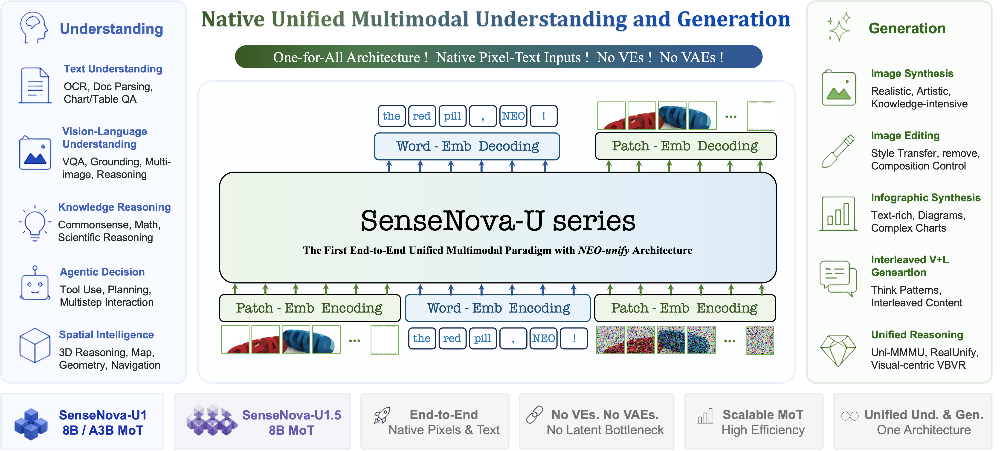
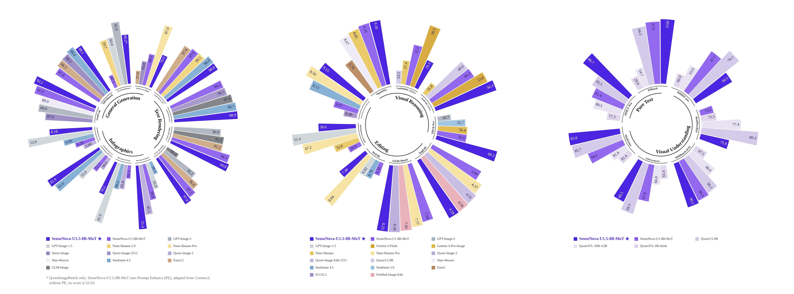
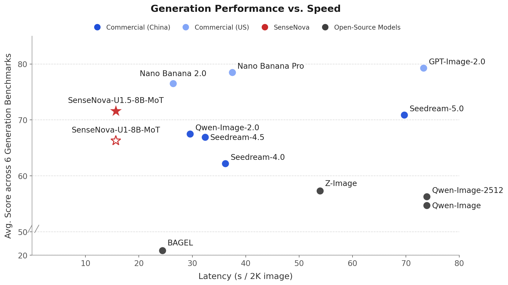

# SenseNova-U：原生多模态理解与生成

<a href="./README.md">English</a> | <strong>简体中文</strong>

  
  
  
  
  
  
  
  
  

## 模型概览

SenseNova-U 是基于 [NEO-unify](https://huggingface.co/blog/sensenova/neo-unify) 的原生多模态模型家族。同一个模型可以理解图像、生成或编辑图像，也可以在回答中交替输出文字和图片。[U1](https://arxiv.org/abs/2605.12500) 首次实现这一方向；[U1.5](https://arxiv.org/abs/2609.11929) 进一步采用 8B-MoT 模型、无需独立视觉编码器和 VAE 的视觉路径，以及具有空间连续性的图像重建方法。

**U1.5** 重点改善了四类实际任务：

- **图像生成**：支持最高原生 4K 分辨率，改进构图、局部细节和材质表现。
- **文字与版式**：改善海报、信息图等结构化图像中的中英文文字。
- **图像编辑**：支持局部修改和多图参考，更好地保留主体身份与未修改区域。
- **视觉理解与图文交错**：支持图像问答，以及文字和图片交替出现的内容生成。

本仓库提供 U1 和 U1.5 的推理示例、训练代码及文档。[U1.5 指南](docs/u1.5_model_CN.md)介绍当前权重及其限制；[效果展示](docs/u1.5_showcases_CN.md)收录生成和编辑案例。

## 近期更新

- **2026-11-04**：发布 [U1.5 TailSteer](https://huggingface.co/sensenova/SenseNova-U1.5-8B-MoT-TailSteer) 完整权重，改善连续多轮图像编辑的稳定性。使用现有编辑脚本，将模型路径指向该权重即可。
- **2026-09-24**：发布 [U1.5 8 步 V2 LoRA](https://huggingface.co/sensenova/SenseNova-U1.5-8B-MoT-LoRAs/blob/main/SenseNova-U1.5-8B-MoT-LoRA-8step-V2.safetensors)。相比第一版 8 步适配器，V2 改善了色彩平衡与对比度，并减轻过锐化；使用时需搭配 U1.5 基座。
- **2026-09-11**：发布 [U1.5 技术报告](docs/pdf/SenseNOVA_U1_5.pdf)，介绍模型架构、训练方法和评测结果。
- **2026-08-20**：发布 [U1.5](https://huggingface.co/sensenova/SenseNova-U1.5-8B-MoT)及[首版 8 步 LoRA](https://huggingface.co/sensenova/SenseNova-U1.5-8B-MoT-LoRAs/blob/main/SenseNova-U1.5-8B-MoT-LoRA-8step.safetensors)。相比 Preview，U1.5 在指令遵循、文字与版式、原生 4K 生成和图像编辑上进一步改进。
- **2026-07-31**：发布 [U1.5 Preview](docs/u1.5_preview_CN.md)，重点改进原生 4K 生成、局部纹理、复杂版式，以及编辑时对主体的保留。
- **2026-07-16**：发布 [U1 信息图 V3](docs/u1_infographic_model_CN.md)，将信息图生成与编辑整合到同一模型，支持局部文字修改，以及整体风格和版式调整。
- **2026-06-29**：发布 [U1 信息图 V2](docs/u1_infographic_model_CN.md)，改进密集文字、复杂版式和整体画面协调性。
- **2026-06-11**：发布 [U1 图文交错模型](https://huggingface.co/sensenova/SenseNova-U1-8B-MoT-Interleaved)，改善多页内容的叙事连贯性、人物与风格一致性。
- **2026-05-21**：开放 [U1 全参训练代码](training/README.md)。

## U1.5 权重

其他发布版本和社区集成见[模型目录](docs/models_CN.md)。

| 权重 | 类型 | 适用任务 | 使用说明 |
| --- | --- | --- | --- |
| [SenseNova-U1.5-8B-MoT](https://huggingface.co/sensenova/SenseNova-U1.5-8B-MoT) | 完整权重 | 文生图、图像编辑、图文交错、视觉问答 | [指南](docs/u1.5_model_CN.md) · [案例](docs/u1.5_showcases_CN.md) |
| [SenseNova-U1.5-8B-MoT-LoRA-8step-V2](https://huggingface.co/sensenova/SenseNova-U1.5-8B-MoT-LoRAs/blob/main/SenseNova-U1.5-8B-MoT-LoRA-8step-V2.safetensors) | LoRA 适配器；需搭配 U1.5 | 8 步文生图、图像编辑、图文交错 | [LoRA 用法](docs/u1.5_model_CN.md#8-步-v2-lora) |

## 快速开始

建议用尽量空闲的 Linux 单卡 CUDA 机器，按 **24 GB 显存、64 GB 系统内存**规划，另为 U1.5 权重预留约 **35 GB 磁盘空间**。先安装 [uv](https://docs.astral.sh/uv/getting-started/installation/)；下面的命令使用 Python 3.11 和 `balanced` 显存模式。

~~~bash
git clone --depth 1 https://github.com/OpenSenseNova/SenseNova-U1.git
cd SenseNova-U1
uv sync --locked --python 3.11
source .venv/bin/activate

hf download sensenova/SenseNova-U1.5-8B-MoT \
  --local-dir ./models/SenseNova-U1.5-8B-MoT

python examples/t2i/inference.py \
  --model_path ./models/SenseNova-U1.5-8B-MoT \
  --prompt "A cinematic mountain lake at sunrise, realistic photography." \
  --width 2048 --height 2048 --num_steps 50 \
  --vram_mode balanced --attn_backend sdpa \
  --output output.png
~~~

`balanced` 会占用系统内存。RTX 5090 测试中的进程 CPU RSS 峰值约 52.2 GiB，因此上面按 64 GB 系统内存规划。

环境配置见[安装指南](docs/installation_CN.md)，其他任务的命令见[任务示例](examples/README_CN.md)。8 步 V2 LoRA 的命令见[U1.5 模型指南](docs/u1.5_model_CN.md#8-步-v2-lora)；[U1.5 显存与 8 步耗时](docs/u1.5_inference_CN.md)记录了 RTX 5090 和 H100 分配器限额测试。

## U1.5 评测

下方两张图概览 U1.5 的公开评测；分项分数见[详细结果](docs/assets/benchmarks/u1.5_combined.webp)。

## U1.5 图像样例

图中结果使用 U1.5 基座权重。<a href="docs/assets/u1.5_teaser2.webp">原尺寸拼图（约 45 MiB）</a>另行提供；单独案例及提示词见 <a href="docs/u1.5_showcases_CN.md">U1.5 效果展示</a>。

## 文档

完整的权重列表和社区版本见[模型目录](docs/models_CN.md)。

### 模型指南与案例

| 版本 | 适用范围 | 指南 | 案例 |
| --- | --- | --- | --- |
| U1.5 | 图像生成、编辑、图文交错和视觉理解 | [指南](docs/u1.5_model_CN.md) | [案例](docs/u1.5_showcases_CN.md) |
| U1.5 Preview | 原生 4K 生成和图像编辑 | [指南](docs/u1.5_preview_CN.md) | [案例](docs/u1.5_preview_showcases_CN.md) |
| U1 信息图 V1–V3 | 信息图生成和编辑 | [指南](docs/u1_infographic_model_CN.md) | [案例](docs/u1_infographic_showcases_CN.md) |
| U1 | 初代 8B、A3B 和图文交错权重 | [指南](docs/u1_model_CN.md) | [案例](docs/showcases_CN.md) |

### 运行与扩展

本地推理先看[安装指南](docs/installation_CN.md)和[任务示例](examples/README_CN.md)。[U1.5 显存与 8 步耗时](docs/u1.5_inference_CN.md)记录 RTX 5090 和 H100 分配器限额测试；8 步 V2 LoRA 命令见[模型指南](docs/u1.5_model_CN.md#8-步-v2-lora)。常见问题见 [FAQ](docs/FAQ_CN.md)。

- **U1 服务部署：**[LightLLM + LightX2V 部署步骤](docs/deployment_CN.md)、[架构与历史测量](docs/inference_infra_CN.md)。使用独立的 Docker 环境。
- **训练：**[训练代码与环境](training/README.md)。
- **提示词增强：**可选的 [U1.5](docs/u1.5_best_practices_CN.md)和 [U1](docs/prompt_enhancement_CN.md) 流程。

## 贡献者

提交记录见 [GitHub 贡献者页面](https://github.com/OpenSenseNova/SenseNova-U1/graphs/contributors)。发现问题可提 [Issue](https://github.com/OpenSenseNova/SenseNova-U1/issues)；代码、案例和文档改动可提 [PR](https://github.com/OpenSenseNova/SenseNova-U1/pulls)。新增官方权重时，请参考[模型文档流程](docs/contributing/model_release_CN.md)。

## 社区交流

欢迎在 [Discord](https://discord.com/invite/BuTXPHmQub) 交流，或通过 [SenseNova 在线体验](https://unify.light-ai.top/)试用模型。加入飞书交流群，请打开[原尺寸二维码](docs/assets/feishu.png)，再用飞书扫码。

## 论文、引用与许可证

[U1.5 论文](https://arxiv.org/abs/2609.11929)、[U1.5 技术报告](docs/pdf/SenseNOVA_U1_5.pdf)和 [U1 论文](https://arxiv.org/abs/2605.12500)提供技术细节。

~~~bibtex
@misc{sensenova2026neounify,
  title   = {NEO-unify: Building Native Multimodal Unified Models End to End},
  author  = {SenseNova},
  url     = {https://huggingface.co/blog/sensenova/neo-unify},
  year    = {2026}
}

@article{sensenova2026sensenovau1,
  title   = {SenseNova-U1: Unifying Multimodal Understanding and Generation with NEO-unify Architecture},
  author  = {Diao, Haiwen and Wu, Penghao and Deng, Hanming and Wang, Jiahao and Bai, Shihao and Wu, Silei and Fan, Weichen and Ye, Wenjie and Tong, Wenwen and Fan, Xiangyu and others},
  journal = {arXiv preprint arXiv:2605.12500},
  year    = {2026}
}

@article{sensenova2026sensenovau1.5,
  title   = {SenseNova-U1.5: Towards Native Unified Visual Intelligence},
  author  = {Diao, Haiwen and Wang, Jiahao and Ding, Chenjing and Deng, Hanming and Chen, Jiangnan and Zhang, Ruixi and Wang, Ruohui and Tong, Wenwen and Fan, Xiangyu and Wang, Yubo and others},
  journal = {arXiv preprint arXiv:2609.11929},
  year    = {2026}
}
~~~

仓库代码使用 [Apache 2.0 许可证](LICENSE)。模型权重的使用条件请以对应模型卡的许可证为准。
