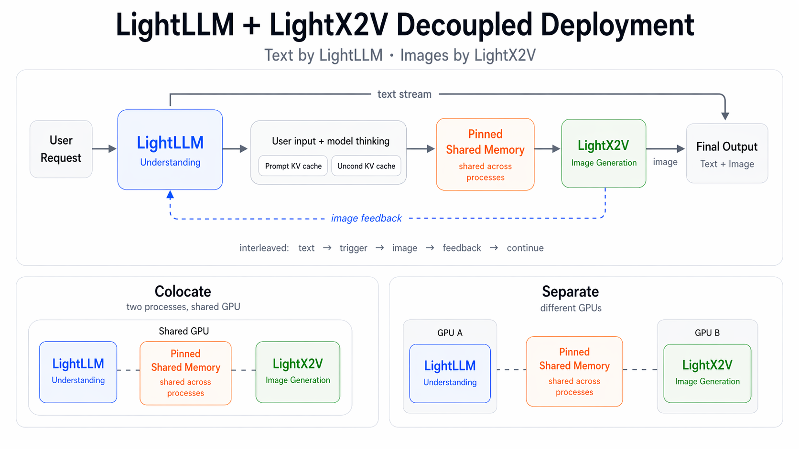
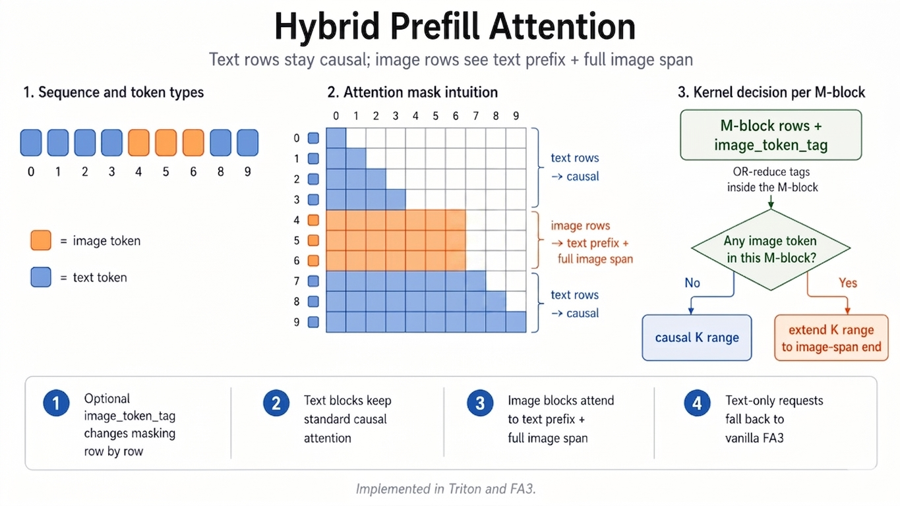

# U1 inference infrastructure

This document describes the inference infrastructure behind **SenseNova-U1**, built on top of **[LightLLM](https://github.com/ModelTC/lightllm)** and **[LightX2V](https://github.com/ModelTC/lightx2v)**.

## Overview

U1 serving uses two engines:

- **LightLLM** for understanding, text streaming, and control flow
- **LightX2V** for image generation

The engines exchange generation state through pinned shared memory and transfer kernels. You can configure parallelism and GPU resources separately, for example tensor parallelism (`TP=2`) for understanding and CFG parallelism (`CFG=2`) or sequence parallelism (`SP=2`) for generation.

There are two ways to assign GPUs:

- **Separate**: LightLLM and LightX2V run on different GPU groups.
- **Colocate**: LightLLM and LightX2V run as separate processes on the same GPU.

See the [deployment guide](deployment.md) for the launch options.

### Attention for Multimodal Prefill of NEO-Unify

NEO-Unify's prefill attention is not standard causal attention. Text tokens remain causal, while image tokens attend to the full text prefix together with the entire image span. To support this hybrid masking pattern, we modified both attention implementations in our stack: the Triton kernel and the official FlashAttention3 (FA3) codebase. Our FA3 branch is available at [WANDY666/flash-attention](https://github.com/WANDY666/flash-attention).

Concretely, we introduced an optional image_token_tag argument that adjusts the mask row by row. Text rows keep the standard causal mask. Image rows, instead of using plain causal truncation, are allowed to attend to all preceding text tokens and all image tokens within the image span.

To preserve the causal-triangle speedup whenever possible, the kernel makes the decision per M-block. It OR-reduces the image_token_tag values inside the current block: if the block contains no image token, it keeps the standard causal K-range; if the block contains image tokens, it extends the K-range to cover the required image span. As a result, pure-text blocks still follow the normal causal path, while only the relevant blocks pay the extra work needed by the hybrid mask.

The overhead therefore does not depend on a fixed ratio, but on how image tokens are distributed across the sequence and across M-block boundaries. When image rows are concentrated in only part of the sequence, the extra work is correspondingly localized. For text-only requests, image_token_tag is empty, and the kernel falls back to vanilla FA3 with no additional overhead.
The table compares Triton and FA3 implementations for Neo-style multimodal prefill (early U1 runs):

- **Triton implementation**: easier to migrate into existing codebases, with lower
  integration cost and faster iteration.
- **FA3 implementation**: higher absolute performance on supported hardware.

|  batch  | max_seq_len | image_token_num | triton (ms) | FA3 (ms) | speedup (×) |
|:-------:|:-----------:|:---------------:|:-----------:|:--------:|:-----------:|
|    8    |     4096    |       88        |    1.95     |   0.81   |  **2.41×**  |
|    8    |     8192    |       171       |    6.55     |   2.68   |  **2.45×**  |
|    8    |    65536    |       150       |   43.30     |  14.95   |  **2.90×**  |
|   16    |     4096    |       379       |    4.12     |   1.68   |  **2.46×**  |
|   16    |     8192    |       246       |   17.76     |   7.40   |  **2.40×**  |
|   16    |    65536    |       206       |  107.74     |  33.66   |  **3.20×**  |
|   32    |     4096    |       726       |    8.46     |   3.46   |  **2.44×**  |
|   32    |     8192    |       536       |   31.74     |  13.24   |  **2.40×**  |
|   32    |    65536    |       417       |  171.00     |  58.26   |  **2.94×**  |
|   64    |     4096    |       1170      |   16.08     |   6.88   |  **2.34×**  |
|   64    |     8192    |       1177      |   55.48     |  22.91   |  **2.42×**  |
|   64    |    65536    |       1291      |  348.89     | 124.82   |  **2.80×**  |
|  128    |     4096    |       2057      |   30.89     |  12.53   |  **2.47×**  |
|  128    |     8192    |       2196      |  104.73     |  43.22   |  **2.42×**  |
|  128    |    65536    |       2205      |  706.60     | 241.67   |  **2.92×**  |

### Deployment

For a concise deployment runbook (Docker image, startup command, and API tests),
see [`deployment.md`](./deployment.md).

### Generation Performance

The table below records historical **2048x2048** image generation times for **SenseNova-U1-8B-MoT (NEO-Unify)**.
Note: TP2+CFG2 means Tensor Parallel=2 + CFG Parallel=2.

| GPU  | Deployment Config | Per-step Latency (s/step) | End-to-end Latency (s) |
|:----:|:-----------------:|:-------------------------:|:----------------------:|
| H100 | TP2+CFG2 / colocate | 0.158 | 9.23 |
| H200 | TP2+CFG2 / colocate | 0.152 | 9.54 |
| 5090 | TP2+CFG2 / separate | 0.415 | 23.04 |
| L40S | TP2+CFG2 / separate | 0.443 | 25.62 |

In NEO-Unify, the KV cache for the generation stage is provided by the understanding module, so T2I (generation) and I2I (editing) have similar runtime characteristics.
