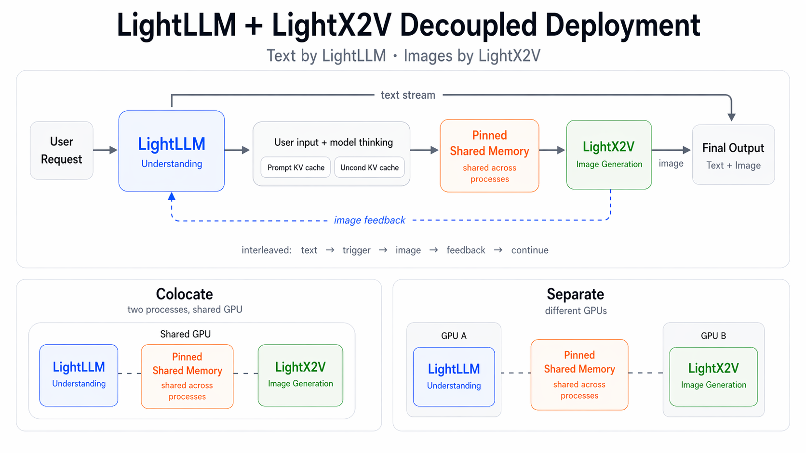
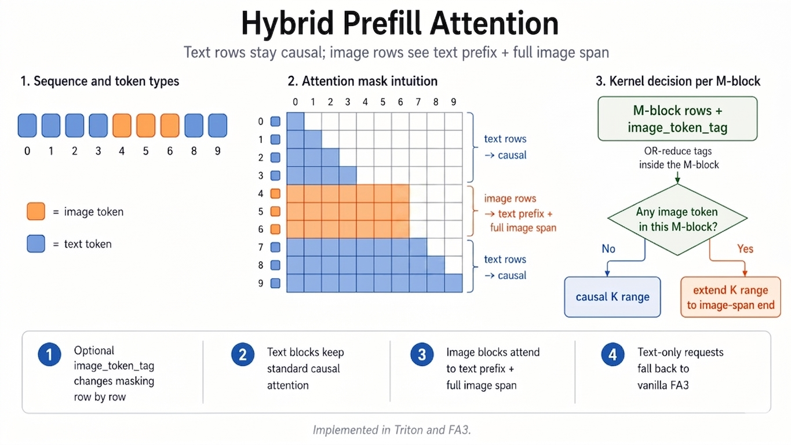

# U1 推理基础设施

本文档介绍 **SenseNova-U1** 的推理基础设施，其构建于 **[LightLLM](https://github.com/ModelTC/lightllm)** 与 **[LightX2V](https://github.com/ModelTC/lightx2v)** 之上。

## 总览

U1 服务由两个引擎组成：

- **LightLLM** 负责理解、文本流式输出与控制流；
- **LightX2V** 负责图像生成。

两个引擎通过 pinned 共享内存与传输内核交换生成状态。理解与生成可分别配置并行方式和 GPU 资源，例如理解侧使用张量并行（`TP=2`），生成侧使用 CFG 并行（`CFG=2`）或序列并行（`SP=2`）。

部署时有两种 GPU 分配方式：

- **Separate（分离部署）**：LightLLM 与 LightX2V 运行在不同的 GPU 组上；
- **Colocate（共置部署）**：LightLLM 与 LightX2V 作为独立进程运行在同一张 GPU 上。

两种模式的启动参数见[部署文档](deployment_CN.md)。

### NEO-Unify 多模态 Prefill 的注意力

NEO-Unify 的 prefill 注意力并非标准因果注意力：文本 token 仍保持因果，而图像 token 则会同时关注整个文本前缀以及完整的图像 span。为支持这种混合掩码，我们对栈内两套注意力实现都进行了改造——Triton 内核与官方 FlashAttention3 (FA3) 代码库。我们的 FA3 分支见 [WANDY666/flash-attention](https://github.com/WANDY666/flash-attention)。

具体做法是新增一个可选的 image_token_tag 参数，用以逐行调整掩码：文本行沿用标准因果掩码；图像行不再采用朴素的因果截断，而是被允许关注其之前的全部文本 token，以及所在图像 span 内的全部图像 token。

为在尽可能多的情况下保留因果三角形带来的加速，内核按 M-block 粒度进行判断——对当前 block 内的 image_token_tag 做 OR-reduce：若该 block 不含图像 token，则维持标准因果 K-range；若含有图像 token，则将 K-range 扩展至覆盖所需的图像 span。因此纯文本 block 仍走常规因果路径，只有真正相关的 block 才承担混合掩码引入的额外开销。

额外开销并不取决于某个固定比例，而是取决于图像 token 在序列中的分布，以及它们跨 M-block 边界的方式。当图像行仅集中在序列的某一部分时，额外开销也被相应地局部化。对于纯文本请求，image_token_tag 为空，内核即回落至原生 FA3，没有任何额外开销。

下表对比 Neo 风格多模态 prefill 的 Triton 和 FA3 实现（早期 U1 测试）：

- **Triton 实现**：更容易迁移到现有代码库，集成成本低、迭代更快；
- **FA3 实现**：在受支持的硬件上绝对性能更高。

|  batch  | max_seq_len | image_token_num | triton (ms) | FA3 (ms) | 加速比 (×) |
|:-------:|:-----------:|:---------------:|:-----------:|:--------:|:----------:|
|    8    |     4096    |       88        |    1.95     |   0.81   |  **2.41×** |
|    8    |     8192    |       171       |    6.55     |   2.68   |  **2.45×** |
|    8    |    65536    |       150       |   43.30     |  14.95   |  **2.90×** |
|   16    |     4096    |       379       |    4.12     |   1.68   |  **2.46×** |
|   16    |     8192    |       246       |   17.76     |   7.40   |  **2.40×** |
|   16    |    65536    |       206       |  107.74     |  33.66   |  **3.20×** |
|   32    |     4096    |       726       |    8.46     |   3.46   |  **2.44×** |
|   32    |     8192    |       536       |   31.74     |  13.24   |  **2.40×** |
|   32    |    65536    |       417       |  171.00     |  58.26   |  **2.94×** |
|   64    |     4096    |       1170      |   16.08     |   6.88   |  **2.34×** |
|   64    |     8192    |       1177      |   55.48     |  22.91   |  **2.42×** |
|   64    |    65536    |       1291      |  348.89     | 124.82   |  **2.80×** |
|  128    |     4096    |       2057      |   30.89     |  12.53   |  **2.47×** |
|  128    |     8192    |       2196      |  104.73     |  43.22   |  **2.42×** |
|  128    |    65536    |       2205      |  706.60     | 241.67   |  **2.92×** |

### 部署

Docker 镜像、启动命令与 API 测试的简明操作手册，请参见 [`deployment_CN.md`](./deployment_CN.md)。

### 生成性能

下表记录 **SenseNova-U1-8B-MoT（NEO-Unify）** 在 **2048x2048** 图像生成任务上的历史耗时。
注：TP2+CFG2 表示张量并行=2 + CFG 并行=2。

| GPU  | 部署配置 | 单步延迟 (s/step) | 端到端延迟 (s) |
|:----:|:--------:|:-----------------:|:--------------:|
| H100 | TP2+CFG2 / colocate | 0.158 | 9.23 |
| H200 | TP2+CFG2 / colocate | 0.152 | 9.54 |
| 5090 | TP2+CFG2 / separate | 0.415 | 23.04 |
| L40S | TP2+CFG2 / separate | 0.443 | 25.62 |

在 NEO-Unify 中，生成阶段所用的 KV cache 由理解模块提供，因此 T2I（文生图）与 I2I（图像编辑）有相近的运行时特征。
