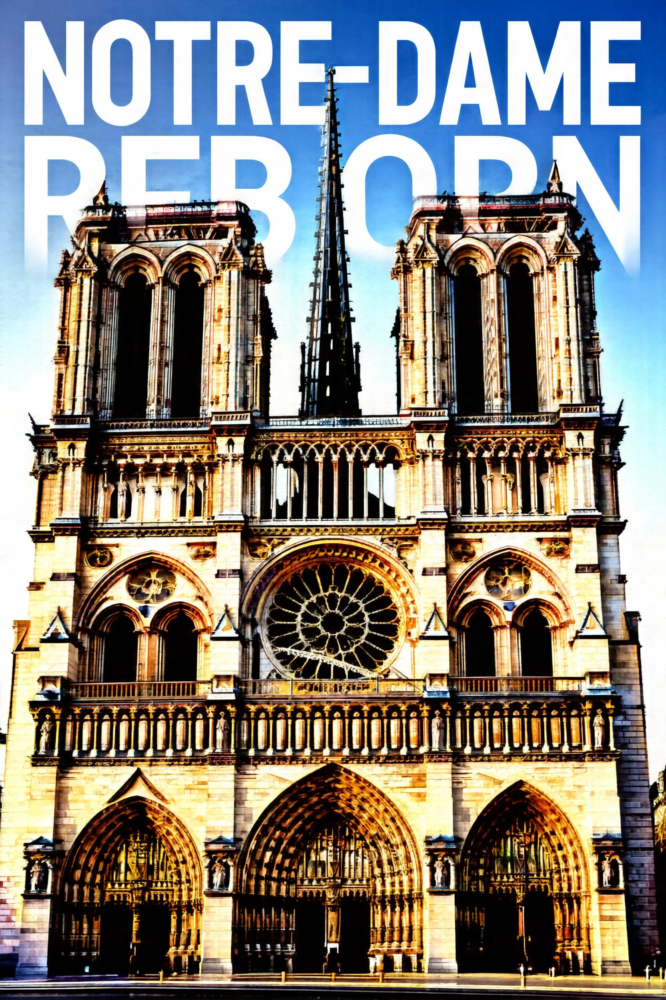
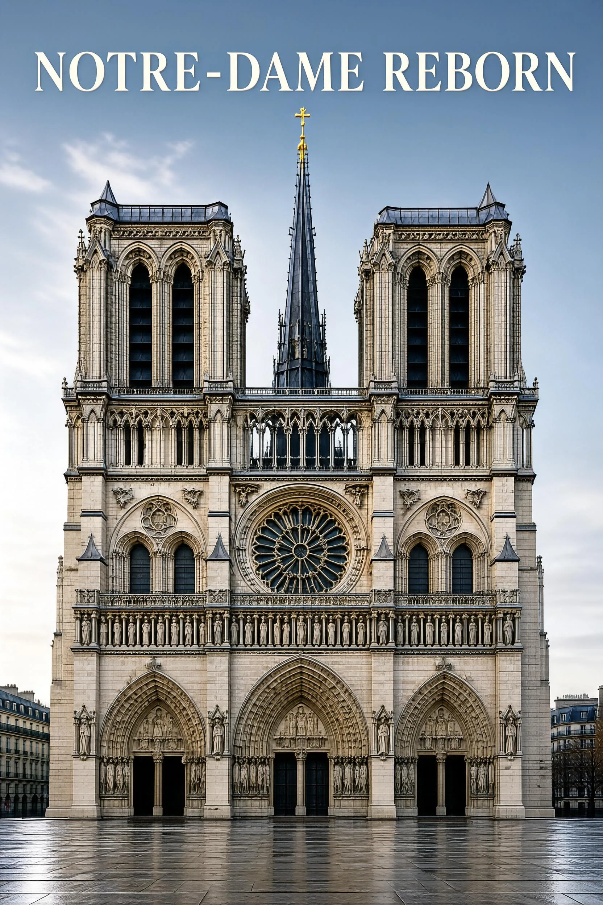
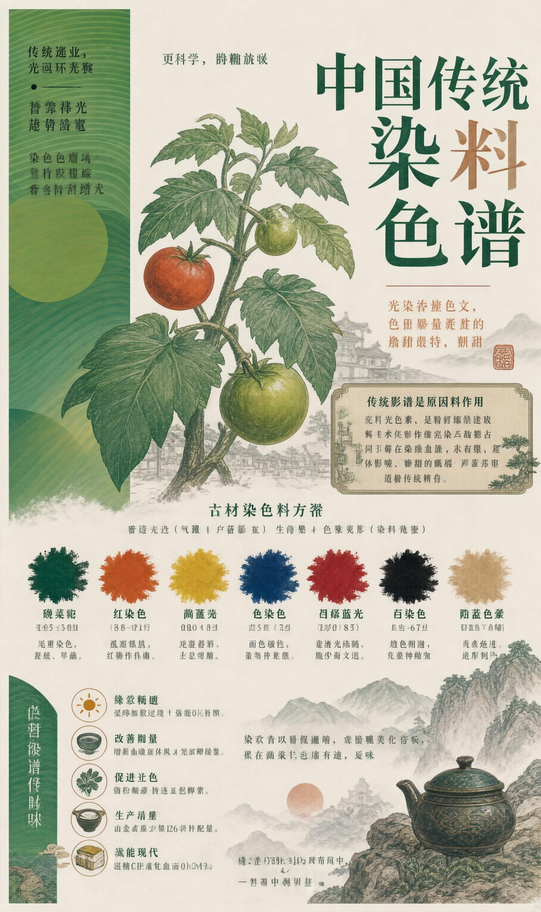
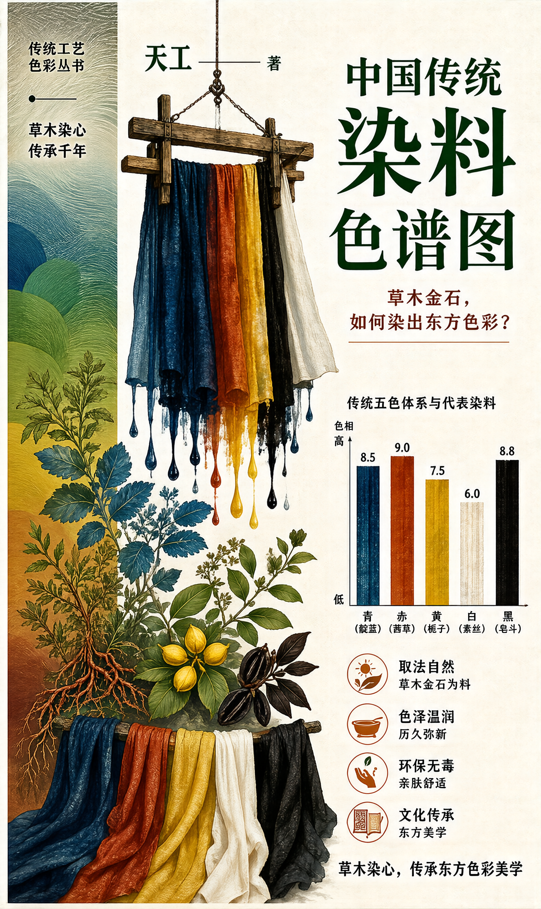

# Optional prompt enhancement for SenseNova-U1.5

<p align="center">
  <strong>English</strong> | <a href="./u1.5_best_practices_CN.md">简体中文</a>
</p>

Image PE expands a short request into a prompt; Caption-to-Prompt describes a reference image; Editing PE rewrites an editing instruction. These tools run before inference, and some require a separate API. U1.5 inference does not depend on them. For setup and basic commands, see the [model guide](u1.5_model.md).

## Prompt workflows

### Image prompt expansion (Image PE)

Use the standalone [Image PE script](../src/sensenova_u1_5/image_pe.py) to convert a short brief into compact Render JSON while preserving required subjects, visible copy, counts, layout constraints, and exclusions. It is a Python entrypoint for any OpenAI-compatible Responses API:

```bash
pip install openai
export PE_MODEL_API_KEY="your-api-key"
export PE_MODEL_API_BASE_URL="https://your-provider.example/v1"

python src/sensenova_u1_5/image_pe.py \
  --prompt "Create a vertical independent book-fair poster. Exact copy: 'PAPER TRAIL', '7 NOV', 'CENTRAL LIBRARY'. Add no other text." > enhanced_prompt.json
```

Pass the resulting JSON directly to text-to-image inference:

```bash
python examples/t2i/inference.py \
  --model_path sensenova/SenseNova-U1.5-8B-MoT \
  --prompt "$(cat enhanced_prompt.json)" \
  --width 1664 --height 2496 \
  --device_map auto \
  --output output.png
```

The script defaults to `gpt-5.6-terra`. With a GPT model that supports hosted search, add `--enable-gpt-search` to check facts needed by the prompt:

```bash
python src/sensenova_u1_5/image_pe.py \
  --prompt "Search the web to verify the west facade and reconstructed spire of Notre-Dame de Paris after its 2024 reopening. Create a portrait architecture-magazine cover titled 'NOTRE-DAME REBORN' with no other text." \
  --enable-gpt-search
```

Comparison: each pair below uses the same U1.5 model and canvas settings to illustrate outputs before and after Image PE.

<table>
  <thead>
    <tr>
      <th width="34%">Prompt before PE</th>
      <th width="33%">Before PE</th>
      <th width="33%">After PE</th>
    </tr>
  </thead>
  <tbody>
    <tr>
      <td valign="top">
        <details>
          <summary><b>Independent Book-Fair Poster</b></summary>
          <pre><code>Create a vertical independent book-fair poster. Exact copy: “PAPER TRAIL”, “7 NOV”, “CENTRAL LIBRARY”. Add no other text.</code></pre>
        </details>
      </td>
      <td align="center" valign="middle">
        <a href="./assets/showcases/image_pe/paper_trail_before_pe.webp"></a>
      </td>
      <td align="center" valign="middle">
        <a href="./assets/showcases/image_pe/paper_trail_after_pe.webp"></a>
      </td>
    </tr>
    <tr>
      <td valign="top">
        <details>
          <summary><b>Notre-Dame Architecture Cover</b></summary>
          <pre><code>Search the web to verify the west facade and reconstructed spire of Notre-Dame de Paris after its 2024 reopening. Create a portrait architecture-magazine cover titled “NOTRE-DAME REBORN” with no other text.</code></pre>
        </details>
      </td>
      <td align="center" valign="middle">
        <a href="./assets/showcases/image_pe/notre_dame_before_pe.webp"></a>
      </td>
      <td align="center" valign="middle">
        <a href="./assets/showcases/image_pe/notre_dame_after_pe.webp"></a>
      </td>
    </tr>
  </tbody>
</table>

### Reference image description (Caption-to-Prompt)

**Best for:** reconstructing or adapting the composition and visual language of a reference image.

When abstract style terms are insufficient, use the [Caption script](../src/sensenova_u1_5/caption/caption.py) to extract a reference image's visual decisions into an editable prompt:

```bash
pip install openai pillow
export OPENAI_API_KEY="your-api-key"

python src/sensenova_u1_5/caption/caption.py path/to/reference.jpg
python src/sensenova_u1_5/caption/caption.py path/to/reference.jpg > result.json
```

Use the generated prompt as a starting point: preserve the useful layout or visual language while replacing the theme, copy, subject, palette, or local structure. Only use reference images whose source, authorization, and license permit the intended use.

### Editing prompt expansion (Editing PE)

**Best for:** complex edits, multiple input images, or requests with strict preservation requirements.

Editing PE rewrites the prompt; it does not modify pixels itself. State the requested change and everything that must remain unchanged. For multi-image tasks, provide images in their intended order and explain each image's role.

To inspect the rewritten prompt without running generation:

```bash
export OPENAI_API_KEY="your-api-key"

python src/sensenova_u1_5/edit/edit_pe.py \
  path/to/input.png \
  "Change the sky to a sunset while preserving the subject, pose, and framing."
```

Enable it in the editing inference entrypoint with `--use-edit-pe`. Use `--print-edit-pe` to compare the original and rewritten prompts, or `--edit-pe-model` to select the rewriter model.

The following example compares the result from the original prompt with the result after enabling Editing PE. Click an image to view it at its original resolution.

<table>
  <thead>
    <tr>
      <th width="33%" align="center">Input Image</th>
      <th width="33%" align="center">Model Output (without PE)</th>
      <th width="34%" align="center">Model Output (with PE)</th>
    </tr>
  </thead>
  <tbody>
    <tr>
      <td align="center" valign="top">
        <a href="./assets/showcases/editing_pe/input_01.webp"></a>
      </td>
      <td align="center" valign="top">
        <a href="./assets/showcases/editing_pe/original_output_01.webp"></a>
      </td>
      <td align="center" valign="top">
        <a href="./assets/showcases/editing_pe/output_01.webp"></a>
      </td>
    </tr>
  </tbody>
</table>

For generated and edited images with their prompts, see the [U1.5 showcases](u1.5_showcases.md).
