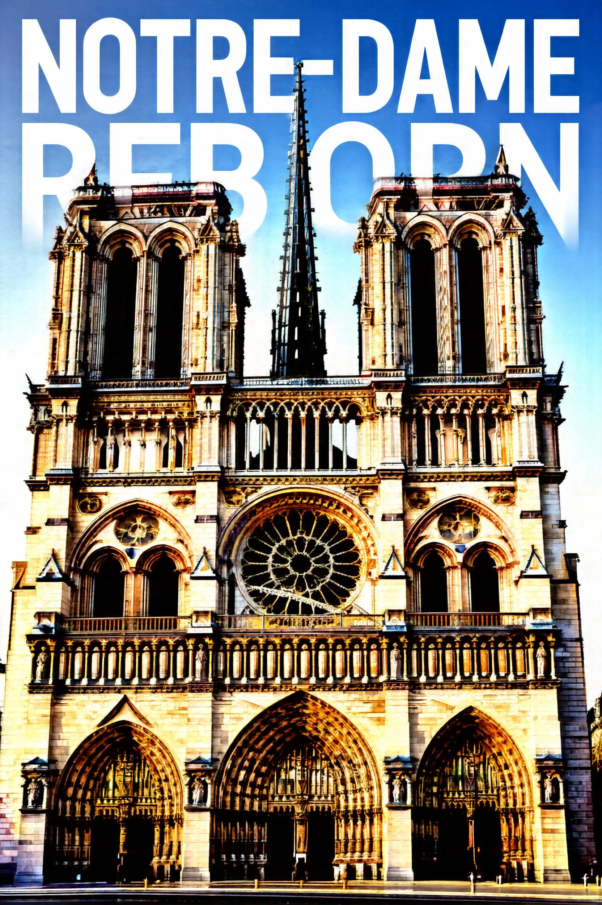
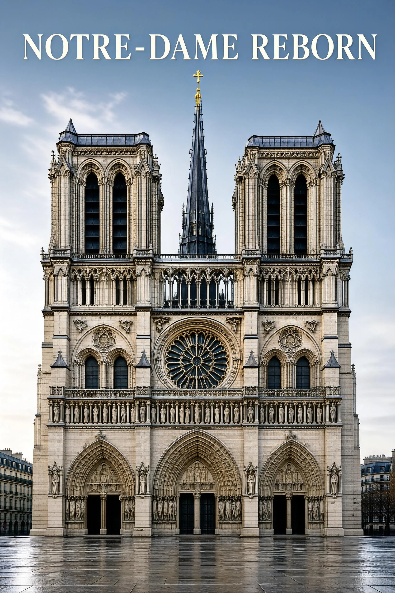

# SenseNova-U1.5 提示词增强（可选）

<p align="center">
  <a href="./u1.5_best_practices.md">English</a> | <strong>简体中文</strong>
</p>

Image PE 把简短需求扩写成提示词；Caption-to-Prompt 描述参考图；Editing PE 改写编辑指令。这三个工具在推理前运行，部分需要单独的 API。U1.5 推理本身不依赖它们，安装与基本命令见[模型指南](u1.5_model_CN.md)。

## 提示词方法

### 图像提示词扩写（Image PE）

使用独立的 [Image PE 脚本](../src/sensenova_u1_5/image_pe.py) 将简短需求转换为紧凑的 Render JSON，同时保留必需主体、可见文案、数量、版式约束和排除项。该脚本可直接调用任意 OpenAI-compatible Responses API：

```bash
pip install openai
export PE_MODEL_API_KEY="your-api-key"
export PE_MODEL_API_BASE_URL="https://your-provider.example/v1"

python src/sensenova_u1_5/image_pe.py \
  --prompt "Create a vertical independent book-fair poster. Exact copy: 'PAPER TRAIL', '7 NOV', 'CENTRAL LIBRARY'. Add no other text." > enhanced_prompt.json
```

将生成的 JSON 直接传给文生图推理：

```bash
python examples/t2i/inference.py \
  --model_path sensenova/SenseNova-U1.5-8B-MoT \
  --prompt "$(cat enhanced_prompt.json)" \
  --width 1664 --height 2496 \
  --device_map auto \
  --output output.png
```

脚本默认使用 `gpt-5.6-terra`。使用支持托管搜索的 GPT 模型时，可加 `--enable-gpt-search` 查询提示词中需要核实的事实：

```bash
python src/sensenova_u1_5/image_pe.py \
  --prompt "Search the web to verify the west facade and reconstructed spire of Notre-Dame de Paris after its 2024 reopening. Create a portrait architecture-magazine cover titled 'NOTRE-DAME REBORN' with no other text." \
  --enable-gpt-search
```

效果对比：下表每组使用相同的 U1.5 模型和画布设置，展示使用 Image PE 前后的模型效果。

<table>
  <thead>
    <tr>
      <th width="34%">PE 前 Prompt</th>
      <th width="33%">PE 前模型效果</th>
      <th width="33%">PE 后模型效果</th>
    </tr>
  </thead>
  <tbody>
    <tr>
      <td valign="top">
        <details>
          <summary><b>独立书展海报</b></summary>
          <pre><code>Create a vertical independent book-fair poster. Exact copy: “PAPER TRAIL”, “7 NOV”, “CENTRAL LIBRARY”. Add no other text.</code></pre>
        </details>
      </td>
      <td align="center" valign="middle">
        <a href="./assets/showcases/image_pe/paper_trail_before_pe.webp"></a>
      </td>
      <td align="center" valign="middle">
        <a href="./assets/showcases/image_pe/paper_trail_after_pe.webp"></a>
      </td>
    </tr>
    <tr>
      <td valign="top">
        <details>
          <summary><b>巴黎圣母院建筑封面</b></summary>
          <pre><code>Search the web to verify the west facade and reconstructed spire of Notre-Dame de Paris after its 2024 reopening. Create a portrait architecture-magazine cover titled “NOTRE-DAME REBORN” with no other text.</code></pre>
        </details>
      </td>
      <td align="center" valign="middle">
        <a href="./assets/showcases/image_pe/notre_dame_before_pe.webp"></a>
      </td>
      <td align="center" valign="middle">
        <a href="./assets/showcases/image_pe/notre_dame_after_pe.webp"></a>
      </td>
    </tr>
  </tbody>
</table>

### 参考图描述（Caption-to-Prompt）

**适合：** 复现或改编参考图的构图和视觉语言。

当抽象风格词不足以表达目标时，可使用 [Caption 脚本](../src/sensenova_u1_5/caption/caption.py) 将参考图的视觉决策提取为可编辑 Prompt：

```bash
pip install openai pillow
export OPENAI_API_KEY="your-api-key"

python src/sensenova_u1_5/caption/caption.py path/to/reference.jpg
python src/sensenova_u1_5/caption/caption.py path/to/reference.jpg > result.json
```

建议将生成的 Prompt 作为起点：保留有价值的版式或视觉语言，同时替换主题、文案、主体、配色或局部结构。仅使用来源、授权和许可协议允许相应用途的参考图。

### 编辑指令扩写（Editing PE）

**适合：** 复杂编辑、多张输入图像或带有严格保留要求的任务。

Editing PE 只负责重写 Prompt，不会自身修改像素。需同时说明要求的变更与必须保持不变的内容。多图任务中，请按预期顺序提供图像，并说明每张图像的作用。

如需在不执行生成的情况下查看重写后的 Prompt：

```bash
export OPENAI_API_KEY="your-api-key"

python src/sensenova_u1_5/edit/edit_pe.py \
  path/to/input.png \
  "Change the sky to a sunset while preserving the subject, pose, and framing."
```

在图像编辑推理入口中使用 `--use-edit-pe` 启用。使用 `--print-edit-pe` 可对比原始与重写后的 Prompt，使用 `--edit-pe-model` 可选择重写模型。

以下示例对比了同一编辑任务在直接使用原始 Prompt 与启用 Editing PE 后的结果。

<table>
  <thead>
    <tr>
      <th width="33%" align="center">输入图片</th>
      <th width="33%" align="center">模型输出(无PE)</th>
      <th width="34%" align="center">模型输出(PE)</th>
    </tr>
  </thead>
  <tbody>
    <tr>
      <td align="center" valign="top">
        <a href="./assets/showcases/editing_pe/input_01.webp"></a>
      </td>
      <td align="center" valign="top">
        <a href="./assets/showcases/editing_pe/original_output_01.webp"></a>
      </td>
      <td align="center" valign="top">
        <a href="./assets/showcases/editing_pe/output_01.webp"></a>
      </td>
    </tr>
  </tbody>
</table>

生成和编辑案例及对应提示词见[U1.5 效果展示](u1.5_showcases_CN.md)。
