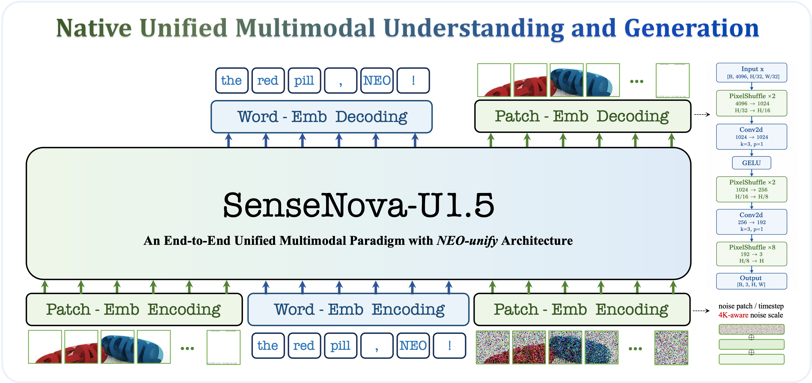

# SenseNova-U1.5-8B-MoT (Preview)

<p align="center">
  <strong>English</strong> | <a href="./u1.5_preview_CN.md">简体中文</a>
</p>

The [Preview checkpoint](https://huggingface.co/sensenova/SenseNova-U1.5-8B-MoT-Preview) has separate weights from [U1.5](u1.5_model.md). The U1.5 8-step V2 LoRA does not apply to Preview. Prompts and outputs are in the [Preview showcase](u1.5_preview_showcases.md).

## Overview

<p align="center">
  
</p>

**SenseNova-U1.5 Preview** extends U1's [NEO-unify](https://huggingface.co/blog/sensenova/neo-unify) architecture with revised patch encoding and image reconstruction. This release focuses on native 4K image generation, text and layout, and image editing with single- or multi-image references. The changes to the model and training data are described below; the reported release results follow the run commands.

## Changes from U1

### Spatial image reconstruction

SenseNova-U1's original MLP head reconstructs each RGB patch independently. At high resolutions, this can expose token boundaries as grid patterns, seams, or texture discontinuities. Preview instead adopts progressive spatial reconstruction via [ConvDecoder](https://github.com/OpenSenseNova/SenseNova-U1/blob/main/src/sensenova_u1/models/neo_unify/modeling_fm_modules.py): visual tokens are reshaped into a two-dimensional feature grid and upsampled through multiple Pixel Shuffle stages, with intermediate `3×3` convolutions enabling neighboring patches to interact and merge into a more continuous image.

### Editing data

SenseNova-U1 relied primarily on publicly available image-editing datasets, many of which contained noisy supervision, low-quality samples, and visible compositing or retouching artifacts. For Preview, the editing corpus was cleaned, filtered, and supplemented with synthetic data, with broader coverage of single-image and multi-image reference settings.

### Structured instructions

The generation and editing corpora used to train Preview contain only a small number of simple JSON-formatted prompts, rather than long, hierarchical instructions. More complex JSON-like formats appear in the understanding training data, with different content and task objectives.

## Run U1.5 Preview

Set up the shared environment with the [installation guide](installation.md), then run these commands from the repository root. Preview has separate weights from U1.5; use the Preview checkpoint in the commands below.

### 🖼️ Text-to-Image

```bash
python examples/t2i/inference.py \
  --model_path sensenova/SenseNova-U1.5-8B-MoT-Preview \
  --prompt "A cinematic mountain lake at sunrise, realistic photography." \
  --width 2048 --height 2048 \
  --device_map auto \
  --output output.png
```

### ✏️ Image Editing

```bash
python examples/editing/inference.py \
  --model_path sensenova/SenseNova-U1.5-8B-MoT-Preview \
  --image input.png \
  --prompt "Change the jacket to cobalt blue. Preserve the face, pose, background, lighting, and framing." \
  --output edited.png
```

The reference configuration for U1.5 Preview is `cfg_scale=4.0`, `timestep_shift=3.0`, and `num_steps=50`.

Shared CLI options for these text-to-image and editing tasks are in the [examples](../examples/README.md).

## Preview release results

The Preview release reported the following scores for the Preview checkpoint, not the later U1.5 weights. The full tables are in the [Preview release results archive](evaluations/u1.5_preview_release.md).

| Task | Metric | U1 | U1.5 Preview |
| --- | --- | ---: | ---: |
| Text-to-image | Qwen-Image Bench Overall, EN / ZH | 48.28 / 45.99 | 49.93 / 50.25 |
| Image editing | WeEdit Average | 6.497 | 6.852 |

## Visual examples

See the [U1.5 Preview showcases](u1.5_preview_showcases.md) for text-to-image, editing, and prompt-enhancement examples.

## Known limitations

Short or underspecified prompts may produce unintended text, and dense small text or mixed Chinese-English copy can contain errors. Check layouts that require exact counts, alignment, or hierarchy, as well as small faces, hands, and limbs. Broad, multi-turn, or multi-reference edits may change regions that were meant to stay intact.
