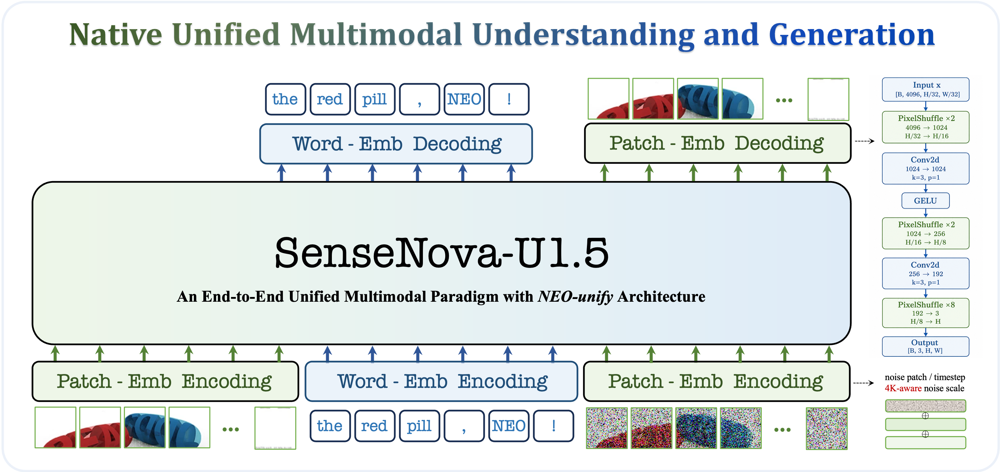

# SenseNova-U1.5-8B-MoT（预览版）

<p align="center">
  <a href="./u1.5_preview.md">English</a> | <strong>简体中文</strong>
</p>

[U1.5 Preview 权重](https://huggingface.co/sensenova/SenseNova-U1.5-8B-MoT-Preview)与 [U1.5](u1.5_model_CN.md) 使用不同权重；U1.5 的 8 步 V2 LoRA 不适用于 Preview。提示词和输出图片见[预览版案例](u1.5_preview_showcases_CN.md)。

## 概述

<p align="center">
  
</p>

**SenseNova-U1.5 Preview** 在 U1 的 [NEO-unify](https://huggingface.co/blog/sensenova/neo-unify) 架构上更新了 patch 编码和图像重建方式，重点面向原生 4K 图像生成、文字与版式，以及单图和多图参考编辑。下文介绍模型与训练数据的变化；运行命令之后保留了发布时的评测结果。

## 相对 U1 的变化

### 空间图像重建

SenseNova-U1 原有的 MLP head 会独立重建每个 RGB patch。在高分辨率下，这可能使 token 边界以网格纹理、接缝或纹理断裂的形式显现。Preview 则通过 [ConvDecoder](https://github.com/OpenSenseNova/SenseNova-U1/blob/main/src/sensenova_u1/models/neo_unify/modeling_fm_modules.py) 采用渐进式空间重建：先将视觉 token 重塑为二维特征网格，再经过多级 Pixel Shuffle 进行上采样，并在中间使用 `3×3` 卷积，让相邻 patch 能够交互并融合为更加连续的图像。

### 编辑数据

SenseNova-U1 主要依赖公开的图像编辑数据集，其中许多数据存在监督噪声、样本质量偏低以及明显的合成或修图伪影。Preview 的编辑语料经过清洗、筛选和合成补充，也扩大了单图参考和多图参考场景的覆盖。

### 结构化指令

用于训练 Preview 的生成与编辑语料只包含少量简单的 JSON 格式提示词，没有长篇、层次化指令。更复杂的类 JSON 格式出现在理解任务训练语料中，其内容和任务目标不同。

## 运行 U1.5 Preview

先按[安装指南](installation_CN.md)配置共用环境，再从仓库根目录运行下文命令。Preview 使用独立于 U1.5 的权重，请使用命令中的 Preview 模型。

### 🖼️ 文生图

```bash
python examples/t2i/inference.py \
  --model_path sensenova/SenseNova-U1.5-8B-MoT-Preview \
  --prompt "A cinematic mountain lake at sunrise, realistic photography." \
  --width 2048 --height 2048 \
  --device_map auto \
  --output output.png
```

### ✏️ 图像编辑

```bash
python examples/editing/inference.py \
  --model_path sensenova/SenseNova-U1.5-8B-MoT-Preview \
  --image input.png \
  --prompt "Change the jacket to cobalt blue. Preserve the face, pose, background, lighting, and framing." \
  --output edited.png
```

U1.5 Preview 的参考配置为 `cfg_scale=4.0`、`timestep_shift=3.0` 和 `num_steps=50`。

文生图和编辑任务的通用参数见[任务示例](../examples/README_CN.md)。

## Preview 发布评测

Preview 发布时报告了以下分数，对应 Preview 权重，不代表后续的 U1.5 权重。完整对比表见[Preview 发布评测资料](evaluations/u1.5_preview_release_CN.md)。

| 任务 | 指标 | U1 | U1.5 Preview |
| --- | --- | ---: | ---: |
| 文生图 | Qwen-Image Bench Overall，EN / ZH | 48.28 / 45.99 | 49.93 / 50.25 |
| 图像编辑 | WeEdit Average | 6.497 | 6.852 |

## 效果展示

文生图、图像编辑及提示词增强案例见[U1.5 Preview 效果展示](u1.5_preview_showcases_CN.md)。

## 已知限制

Preview 遇到简短或含糊的提示词时，可能生成多余文字；密集小字和中英混排也可能出错。要求精确计数、对齐或层级的版式，以及小人脸、手部和肢体细节，需要检查。大范围、多轮或多参考图编辑可能改变本应保留的区域。
