# SenseNova-U1.5 Preview 效果展示

<a href="./u1.5_preview_showcases.md">English</a> | <strong>简体中文</strong>

这些案例使用 U1.5 Preview 权重。[模型指南](u1.5_preview_CN.md)介绍权重、评测、运行方法和限制。

## 文生图

以下示例涵盖多种类型的文生图任务。点击左栏中的标题可展开完整的原始 Prompt。

<table>
  <thead>
    <tr>
      <th width="40%">提示词</th>
      <th width="60%">SenseNova-U1.5（预览版）</th>
    </tr>
  </thead>
  <tbody>
    <tr>
      <td valign="top">
        

          
<b>复古汽水广告</b>

          <pre><code>生成一张竖版复古可乐商业广告海报，品牌为“RETRO-COLA”，画面比例约为 2:3。整体采用 1960—1970 年代美式汽水广告、复古泳池派对摄影、旧杂志印刷和现代商业时尚广告融合的风格。画面必须真实、热烈、复古、富有生活方式气息，不能呈现为插画、卡通、漫画或明显的三维渲染。

场景设定在夏夜的户外露台或泳池派对。背景为深靛蓝色夜空，远处有少量暖黄色虚化灯光和轻微模糊的城市或派对环境。画面顶部撑开一把大型复古遮阳伞，伞面是奶油黄与焦糖橙相间的宽条纹，带真实布料褶皱、纤维质感和边缘流苏。遮阳伞占据画面顶部区域，但不能压住主要文字。

画面右侧中央是一位年轻女性，她是整张海报的人物主角。她有浓密蓬松的深棕色短卷发，佩戴金色圆环耳环、细项链和手镯，皮肤具有真实细腻的暖棕色质感。她表情自然、开怀大笑，充满夏夜派对的放松与感染力，像真实抓拍而不是僵硬摆拍。

她穿一件黄色与奶油白色格纹的复古修身连体泳装或复古吊带连衣装，胸口为复古收褶结构，肩带清楚，服装贴合身体但自然不过度夸张。人物采用稳定清晰的三分之四正面坐姿，稳定地坐在一个装满透明冰块的大型黄色金属冰桶里。上半身完整可见，头部、颈部、双肩、双臂和躯干结构清楚。她的背部自然挺直，肩膀放松，左右肩高度合理，胸腔和腰部略微朝向镜头，人体比例真实。

肢体结构必须清楚、简洁、稳定。画面中只保留主角自己的一双手，不要出现第三只手、额外手臂或从镜头外伸入的其他人的手。她的右手握住一瓶玻璃瓶装可乐，将瓶子自然举在胸口附近。右上臂贴近身体，手肘自然弯曲，前臂方向清楚。右手必须完整呈现五根手指，拇指在瓶身一侧，其余四指自然环绕瓶身，手指长度、关节和弯曲方向真实，不能粘连、穿模、扭曲，也不能遮挡主要标签文字。左手自然搭在黄色冰桶边缘，手掌放松，五根手指轻轻弯曲并清楚分开，手与桶沿有真实接触关系和轻微阴影，不隐藏在身体后方，也不与冰块、衣服或腿部融合。双臂不能交叉，双手不能遮挡脸部，也不能互相重叠。

腿部也要保持简洁稳定。人物只露出一条自然弯曲抬起的腿，只显示一个清楚的膝盖和部分大腿，膝盖位于画面中央偏右，形状自然，和躯干连接合理。另一条腿完全隐藏在冰桶和冰块内部，不要额外显示第二个膝盖、脚、小腿或重复腿部。冰桶边缘明确遮挡腰部以下位置，遮挡关系自然。不要采用双腿交叉、复杂盘腿、扭曲髋部或不可能的坐姿。

她右手拿着的可乐瓶必须保持真实产品结构：透明深棕色玻璃瓶、细长瓶颈、金属瓶盖、合理玻璃厚度和真实折射。瓶内装深褐色碳酸饮料，液面自然，内部有少量细密气泡，瓶外覆盖冷凝水珠。瓶身红棕色纸质标签上清晰显示品牌文字：
“RETRO-COLA”
使用奶油白色复古粗衬线字体。标签紧贴瓶身曲面，不悬浮、不变形、不重复、不出现乱码。

画面底部中央是一只大型复古黄色金属冰桶，桶壁带真实冷凝水珠、少量磨损和金属反光。桶中堆满不规则透明冰块，冰块有自然裂纹、融水和高光。桶身正面印刷大型红棕色品牌文字：
“DRINK”
“RETRO-COLA”
其中“RETRO-COLA”使用复古弧形衬线字体，带少量星芒装饰，文字要清晰贴合桶体透视。

画面前景左右下角各放置一瓶靠近镜头的 RETRO-COLA 玻璃瓶。两瓶作为前景景深元素，被边缘轻微裁切，并略有前景虚化，但仍然能够辨认出深色玻璃、红棕标签和奶油白品牌文字。除了这两瓶前景产品，不要再加入额外人物手臂，不要有左下角伸手的动作元素。

画面左侧约占四成宽度，放置五行超大黄色英文标题：
“VINTAGE”
“CARBONATED”
“DREAMS!”
“UNCAP”
“THE PAST.”
文字从上到下排列，使用高窄、极粗、略带手工印刷感的无衬线字体，颜色为芥末黄色。五行左对齐、行距紧凑、占据强烈视觉冲击力。标题位于人物左侧的深蓝夜空区域，不覆盖人物面部，不与可乐瓶标签重叠，每一行都必须清晰可读。

顶部中央放置较小黑色标题：
“THE RETRO FIZZ®”
左上角放置三行黄色小字：
“FUTURE”
“RETRO”
“FLAVOR”
右上角放置两行黄色小字：
“RETRO-COLA”
“LIFE 2026”
所有顶部小字均使用窄体粗无衬线字体，紧凑清晰，保持克制，不抢主体。

光线采用夜间派对中的暖色直接闪光灯或暖色商业布光与环境夜色结合。人物、玻璃瓶、冰块和黄色冰桶被温暖而清楚地照亮，皮肤、头发、玻璃瓶和冰块高光真实。背景保持深靛蓝色夜景和少量暖色散景。画面可以带适量复古胶片颗粒、轻微油墨噪点和旧杂志印刷感，但不能牺牲人物面部、手部、产品包装和文字清晰度。

整体配色以深靛蓝、芥末黄、焦糖橙、暖棕色、奶油白和可乐红棕色为主。整体气质像真实拍摄的复古汽水品牌广告，可用于饮料新品发布、夏季派对活动、电商主视觉和社交媒体营销。

特别强调：
主角只有一双手；右手握瓶，左手搭在冰桶边缘；只露出一个膝盖；另一条腿完全藏在冰桶中；不出现额外手臂、额外手指、重复膝盖、扭曲坐姿或肢体融合。</code></pre>
        

      </td>
      <td valign="top" align="center">
        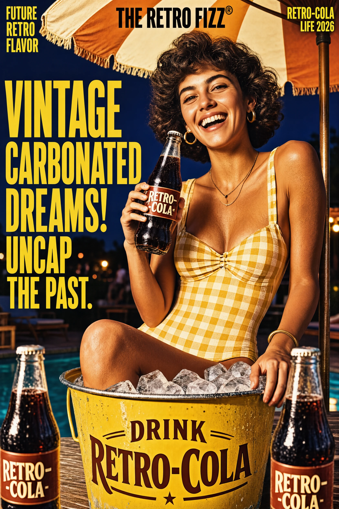
      </td>
    </tr>
    <tr>
      <td valign="top">
        

          
<b>海龟科普信息图</b>

          <pre><code>{
  "type": "circular life-cycle educational infographic poster",
  "theme": "MARINE TURTLES of the MALDIVES - Life Cycle and Threats",
  "language": "English",
  "priority_emphasis": [
    "TOP PRIORITY: all text crisp, correctly spelled, plain letters and numbers only - no strange symbols or garbled characters",
    "core structure: a circular five-stage life cycle arranged clockwise around a central dark-teal oval label, with curved arrows connecting the stages",
    "style: soft watercolor natural-history illustration inside each stage circle, combined with clean flat icons and elegant serif typography",
    "calm coastal palette: soft ocean teals and blues on a very light blue-white background, one warm sand-beige accent band"
  ],
  "canvas": {
    "aspect_ratio": "2:3",
    "orientation": "vertical poster",
    "resolution_hint": "high resolution, refined print-quality detail",
    "background": "very light blue-white with a subtle watercolor wash texture"
  },
  "style": {
    "overall": "elegant marine conservation poster - watercolor illustration meets clean infographic design",
    "visual_tone": "calm, natural, scientific, gentle",
    "art_direction": "each life stage is a circular watercolor vignette with soft edges; around each vignette a pale-teal arc segmented into small flat threat icons; bold curved teal arrows link the stages clockwise; dotted lines connect stages to the center",
    "color_palette": [
      "deep ocean teal (headings, arrows, icons)",
      "soft aqua and powder blue (arcs and fills)",
      "muted seafoam green",
      "warm sand beige (bottom accent band)",
      "very light blue-white background"
    ],
    "saturation": "low to medium, watercolor softness, no bright colors",
    "typeface": "classic serif in dark teal - large elegant serif for the title with an italic word, medium serif for stage names and section headers, clean sans-serif regular for body bullets",
    "references": ["natural history watercolor plates", "marine conservation posters", "editorial life-cycle diagrams"]
  },
  "layout": {
    "header": {
      "title": "MARINE TURTLES of the MALDIVES - large dark-teal serif, the words of the in elegant italic",
      "subtitle": "Life Cycle and Threats - medium serif flanked by small decorative dashes"
    },
    "central_hub": "a solid dark-teal oval in the middle of the cycle with white italic serif text: Life Cycle and Threats",
    "life_cycle_ring": {
      "arrangement": "five stages arranged clockwise: stage 1 top center, stage 2 right, stage 3 lower right, stage 4 lower left, stage 5 left; bold curved teal arrows between consecutive stages; thin dotted lines from each stage toward the central oval",
      "stage_design": "each stage has a numbered dark-teal circle badge on top, a round watercolor illustration, a serif stage name below, and a pale-teal arc of 4-5 small flat threat icons hugging the outer side of the circle (crab, bird, fish, thermometer, net, plastic bottle, no-poaching sign, excavator, boat as appropriate)",
      "stages": [
        {"number": "1", "name": "Eggs and Nest", "illustration": "watercolor female turtle on warm sand laying a clutch of white eggs among beach grass", "side_text": "left column bullets: Females return to natal Maldivian beaches to nest. Clutch approx 80-120 eggs; incubation approx 45-70 days in the warm sand.", "right_text": "right column bullets: Bycatch in fishing gear and ghost-net entanglement. Plastic ingestion, poaching, coastal development and boat strikes."},
        {"number": "2", "name": "Hatchlings", "illustration": "watercolor night beach scene with a tiny hatchling scrambling toward moonlit waves", "side_text": "bullets: Hatchlings emerge at night and scramble to the sea toward the brightest horizon. Survival to adulthood is estimated at only approx 1 in 1,000."},
        {"number": "3", "name": "The Lost Years", "illustration": "watercolor juvenile turtle drifting among Sargassum seaweed and small fish in open blue water", "side_text": "bullets: Juveniles drift on open-ocean currents and Sargassum for years. This long pelagic phase is known as the lost years."},
        {"number": "4", "name": "Sub-adult on Reefs", "illustration": "watercolor young turtle swimming over coral reef and seagrass", "side_text": "bullets: Young turtles recruit to Maldivian coral reefs and seagrass beds. They feed and grow toward maturity in coastal foraging grounds."},
        {"number": "5", "name": "Adult and Migration", "illustration": "watercolor mature turtle swimming through open water with light rays", "side_text": "bullets: Mature adults migrate between foraging and breeding grounds. Sexual maturity is reached late - often 20-30 years."}
      ]
    },
    "species_status_row": {
      "left": "a watercolor hawksbill turtle illustration beside header Maldivian Species with bullets: Five of the seven sea-turtle species occur in Maldivian waters. Green and Hawksbill turtles are the most commonly seen.",
      "right": "a dark-teal shield icon with a white turtle silhouette beside header Conservation Status with bullets: Hawksbill Critically Endangered. Green Endangered (IUCN Red List). A second watercolor green turtle illustration at the far right."
    },
    "threat_bands": {
      "natural": "a full-width pale-teal rounded band titled NATURAL THREATS with four icon-text pairs separated by dotted dividers: crab icon - Predation of eggs and hatchlings by crabs, birds and fish; virus icon - Disease; coral icon - Coral and seagrass loss; storm cloud icon - Storms erode nesting beaches.",
      "human": "below it a full-width warm sand-beige rounded band titled HUMAN THREATS with five icon-text pairs: fishing net - Bycatch in fishing gear and ghost-net entanglement; plastic bottles - Plastic ingestion; turtle with hand - Poaching; excavator - Coastal development; boat - Boat strikes."
    }
  },
  "composition_rules": [
    "the five-stage ring is the dominant structure, evenly spaced around the central oval",
    "watercolor vignettes share a consistent illustration style and scale",
    "threat-icon arcs hug each stage circle on its outer side without touching neighboring elements",
    "side text columns sit outside the ring, aligned left or right, never overlapping the cycle",
    "curved arrows are bold and smooth, clearly showing clockwise flow",
    "the two threat bands stretch the full width at the bottom with even icon spacing",
    "generous breathing room, nothing touches the poster edges"
  ],
  "quality_tags": [
    "watercolor natural-history illustration",
    "circular life-cycle diagram",
    "marine conservation poster",
    "soft coastal palette",
    "elegant serif typography",
    "clean flat icon system",
    "crisp accurate text",
    "high detail"
  ],
  "negative_prompt": [
    "garbled text",
    "misspelled words",
    "strange symbols",
    "blurry small labels",
    "bright neon colors",
    "oversaturated palette",
    "photorealistic turtles",
    "3D render look",
    "cartoon childish style",
    "cluttered overlapping elements",
    "broken cycle arrows",
    "wrong number of stages",
    "watermark",
    "low resolution"
  ]
}</code></pre>
        

      </td>
      <td valign="top" align="center">
        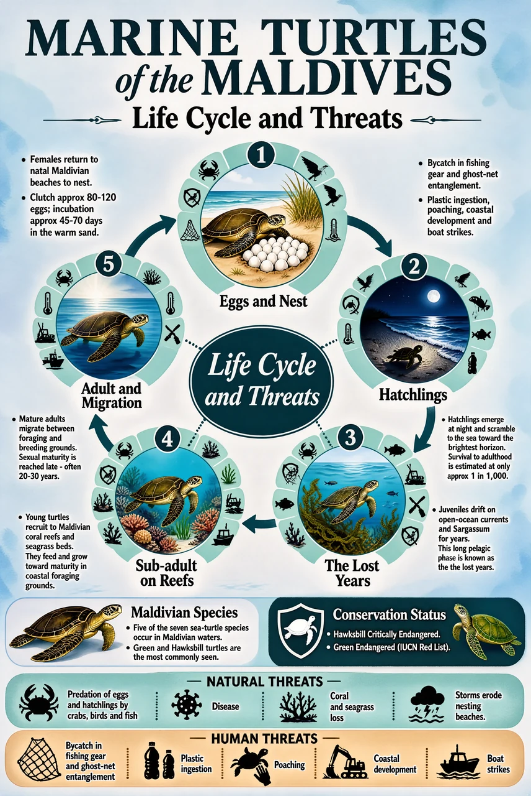
      </td>
    </tr>
    <tr>
      <td valign="top">
        

          
<b>武康路旅行手账</b>

          <pre><code>{
  "类型": "小红书手账风水彩 CityWalk 攻略图",
  "主题": "武康路 —— 上海最出片的一条马路 CITYWALK 漫游",
  "语言": "简体中文（含少量英文点缀）",
  "优先强调": [
    "【最高优先级】所有中文清晰、正确、无错字，只用普通标点、无奇怪字符；手写体标题要有笔触感但可读",
    "核心风格：水彩手绘插画 + 拼贴手账风 —— 做旧牛皮纸底、贴纸、便签、票根、胶带、手写批注、爱心涂鸦，满满小红书种草感",
    "画面丰富热闹但不杂乱，暖色调温柔治愈，像一页精心做的旅行手账"
  ],
  "画布": {
    "比例": "1:1",
    "方向": "方形",
    "画质": "高分辨率，水彩质感细腻，拼贴层次丰富",
    "背景": "做旧暖米色牛皮纸/手账纸底，带轻微纸纹与做旧痕迹"
  },
  "风格": {
    "整体": "水彩手绘 + 拼贴手账 + 小红书攻略排版",
    "视觉基调": "文艺、治愈、温柔、种草、热闹而精致",
    "美术方向": "建筑与街景用柔和水彩手绘（淡彩晕染、细线勾勒），元素以贴纸/便签/票根/胶带拼贴叠放；手写批注、虚线路线、爱心与箭头涂鸦点缀；留白处贴纸标签分区",
    "色板": ["做旧米黄纸底", "水彩砖红（武康大楼）", "柔和绿（梧桐树）", "暖棕、奶咖", "点缀粉、黄、蓝（贴纸标签）"],
    "饱和度": "中低饱和、柔和暖调，水彩通透",
    "字体": "主标题大号黑色毛笔手写体（带彩色描边光晕），小标题手写体，说明清晰小字",
    "参考": ["小红书旅行手账", "水彩城市插画", "拼贴风攻略图"]
  },
  "版式": {
    "主标题": "武康路 —— 超大黑色毛笔手写体，左上角，带粉黄蓝多色手绘描边光晕，贴纸感",
    "副标题": "上海最出片的一条马路 | CITYWALK漫游 —— 手写小字，标题下方",
    "主视觉": "画面右侧中部一栋水彩手绘的武康大楼（诺曼底公寓，砖红色船型转角历史建筑），楼前一位戴草帽、穿米色长裙、手拿咖啡、背小包的女生背影正走过斑马线；旁边水彩梧桐树成荫",
    "拼贴元素": [
      "左上角便签清单：网红面包店 / 转角遇到爱 / 老上海风情（打勾）",
      "右上角贴一枚做旧邮票（梧桐叶图案）与胶带",
      "左侧一张咖啡票根 CAFE de WUKANG 咖啡时光 COFFEE TICKET，配拉花咖啡水彩小图",
      "左中水彩小图：街角咖啡馆（转角遇见浪漫）、老洋房阳台（藏着老上海的故事）",
      "右侧标注：武康大楼（诺曼底公寓）上海地标必打卡机位；法国梧桐 夏日浓荫大道 氛围感拉满",
      "右侧一块蓝色路牌 武康路 Wukang Rd. 393/381",
      "手绘爱心、箭头、相机小图标点缀"
    ],
    "路线地图": "左下角一张水彩手绘 CITYWALK 路线图，标题 武康路CITYWALK路线图；粉色虚线串联编号站点：START 武康大楼(诺曼底公寓) → 2 老洋房群(历史建筑巡礼) → 网红面包店(人气烘焙) → 3 街角咖啡馆(拍照打卡) → 5 复古路牌(打卡留念) → GO! citywalk；沿途水彩小建筑与路树",
    "底部标签": "三枚彩色贴纸话题标签：#武康路 #上海citywalk #出片圣地",
    "TIPS框": "右下角便签 漫步TiPS：穿着舒适的鞋子 / 带上相机-手机 / 慢下来感受生活（打勾）"
  },
  "构图规则": [
    "武康大楼为右侧视觉主体，女生背影引导视线，路线地图锚定左下",
    "各拼贴元素错落叠放、留白呼吸，热闹但不糊成一团",
    "手写标题最醒目，各小标签分区清晰",
    "水彩暖色调统一，全图像一页完整手账"
  ],
  "质量标签": ["水彩手绘手账风", "拼贴种草攻略", "毛笔手写标题", "路线地图", "暖调治愈", "文字清晰", "小红书风", "高清细节"],
  "负向提示": ["乱码汉字", "错字", "奇怪字符", "文字糊成一团", "元素杂乱重叠糊作一团", "浓艳刺眼颜色", "3D渲染感", "照片写实", "冷硬扁平矢量", "空洞留白过多", "水印", "低分辨率"]
}</code></pre>
        

      </td>
      <td valign="top" align="center">
        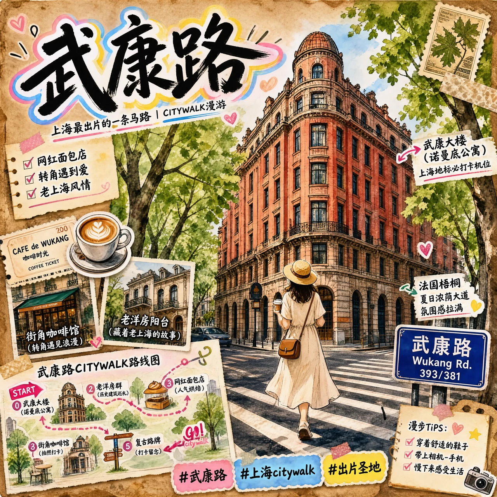
      </td>
    </tr>
    <tr>
      <td valign="top">
        

          
<b>银盐摄影技术图解</b>

          <pre><code>{
  "类型": "精密线描工程科普信息图",
  "主题": "银盐摄影 —— 一束光如何通过化学反应变成一张永久保存的照片",
  "语言": "简体中文（含少量英文年份与术语）",
  "优先强调": [
    "【最高优先级·必须遵守】画面底部及任何位置都绝不出现一排标签/图例胶囊按钮；绝不把风格词、质量词（如 现代工程线描 / 等距爆炸拆解 / 明亮暖米底 / 文字工整 / 高清细节 等）当作内容画进图里。画面只包含标题、时间轴、相机拆解主图与各知识模块正文，此外无任何标签条",
    "【最高优先级】所有中文清晰、正确、无错字，只用普通标点、无奇怪字符",
    "【配色·低饱和】整体低饱和、克制——暖橙色只作极少量点睛（仅用于那一条入射光线），其余引线、箭头、标注一律用中性的黑/深灰，不要满图橙色；底色是干净的浅米白而非偏黄，整体清爽不暖过头",
    "【字重·偏细】文字用中等偏细字重——标题为清爽的中黑体（不要超粗），模块小标题为常规黑体，正文为细黑体/宋体；避免笨重的超粗字堆叠"
  ],
  "画布": {
    "比例": "16:9",
    "方向": "横版",
    "画质": "高分辨率，工程制图级精细度，文字清晰",
    "背景": "干净、明亮的浅米白纸底（偏白、不偏黄），轻微纸纹，清爽通透"
  },
  "风格": {
    "整体": "现代工程线描科普图鉴 meets 信息图排版，清爽克制",
    "视觉基调": "精密、专业、清爽、明亮、轻盈",
    "美术方向": "以细而均匀的黑/深灰钢笔线描为主，线条干净利落；仅一条入射光线用暖橙做点睛，其余全部中性色；剖面分层图、等距爆炸拆解图、细引线标注、编号圆点；模块间以细线或小标题分区",
    "色板": ["浅米白底（偏白不偏黄）", "黑/深灰线描（主）", "极少量暖橙（仅入射光线点睛）", "浅灰淡填充"],
    "饱和度": "低饱和，中性黑灰为主，暖橙极少量点睛，整体清爽不暖腻",
    "字体": "标题中黑体（清爽不超粗），模块小标题常规黑体，正文细黑体/宋体小字",
    "参考": ["现代科普线描信息图", "干净轻盈的工程爆炸拆解图", "清爽技术图解"]
  },
  "版式": {
    "主标题": "银盐摄影 —— 大号中黑体（清爽不超粗），左上角；下方小字副标题 一束光如何通过化学反应变成一张永久保存的照片",
    "顶部时间轴": "银盐摄影发展历程 —— 横向时间轴六节点，各配线描相机小图：达盖尔银版摄影 1839、卡罗式摄影 1841、胶卷时代 1888、黑白胶片普及、彩色胶片 1935、现代艺术银盐摄影",
    "中央主图": "一台胶片相机的等距爆炸拆解线描图（干净细线），部件沿光路展开并编号引线标注：① 相机主体、② 镜头组、③ 快门、④ 胶片仓、⑤ 银盐胶片、⑥ 卷片轴、⑦ 取景器；一条暖橙色光线从镜头射入、标注 光线入射（全图仅此处用橙）；下方圆形放大剖面 银盐乳剂层 与 卤化银晶体结构（晶格球棍模型）",
    "左侧模块": [
      "银盐为什么能记录影像：光子被卤化银晶体吸收使电子跃迁至导带；电子被感光点捕获与银离子结合生成金属银微粒即潜影；约4个以上银原子聚集时晶体才可显影",
      "银盐乳剂结构：剖面分层 保护层 / 银盐乳剂层 / 片基",
      "为什么底片是反的：受光多的区域变黑；受光少的区域较透明；明暗关系反转；配负片小图",
      "银盐摄影流程：横向8步 ① 装入胶卷 → ② 曝光 → ③ 显影 → ④ 定影 → ⑤ 水洗 → ⑥ 干燥 → ⑦ 放大冲印 → ⑧ 获得照片，每步配线描小图标"
    ],
    "右侧模块": [
      "显影发生了什么：显影液作用于潜影；晶体被还原为金属银；影像逐渐显现；配三格晶体变化图",
      "为什么需要定影：清除未曝光的卤化银；仅保留金属颗粒；使底片不再感光；配三格图",
      "为什么胶片会有颗粒感：晶体越大颗粒越粗、越小越细腻；配灰阶颗粒渐变条",
      "银盐摄影与数码摄影：化学感光↔电子感光、胶片记录↔CMOS记录、暗房冲洗↔即时成像",
      "银盐摄影的魅力：四个圆形线描图标 真实颗粒 / 丰富影调 / 独特色彩 / 不可复制的仪式感"
    ]
  },
  "构图规则": [
    "中央相机爆炸图为视觉焦点、光路贯穿",
    "四周模块沿边缘规整排布、各带小标题与编号圆点",
    "引线细而清晰不交叉、编号与文字对应准确",
    "线描为主、暖橙仅入射光线点睛；其余中性黑灰",
    "留白充足、浅米白底统一、清爽不暖腻",
    "文字中等偏细、轻盈不笨重",
    "底部及任何位置都不出现多余的标签胶囊条"
  ],
  "质量标签_内部参考不要画进图": ["现代工程线描", "干净细线", "低饱和清爽", "中等偏细字重", "文字工整", "高清细节"],
  "负向提示": [
    "底部或任何位置的标签胶囊条",
    "把风格词质量词画成图标按钮或标签",
    "满图橙色",
    "过多暖橙点缀",
    "高饱和刺眼颜色",
    "底色偏黄发暖过头",
    "超粗笨重字体",
    "粗黑字堆叠",
    "做旧发黄发暗",
    "厚重铜版雕刻",
    "乱码文字",
    "错字",
    "奇怪字符",
    "文字糊成一团",
    "引线交叉缠绕",
    "3D渲染感",
    "照片写实",
    "水印",
    "低分辨率"
  ]
}</code></pre>
        

      </td>
      <td valign="top" align="center">
        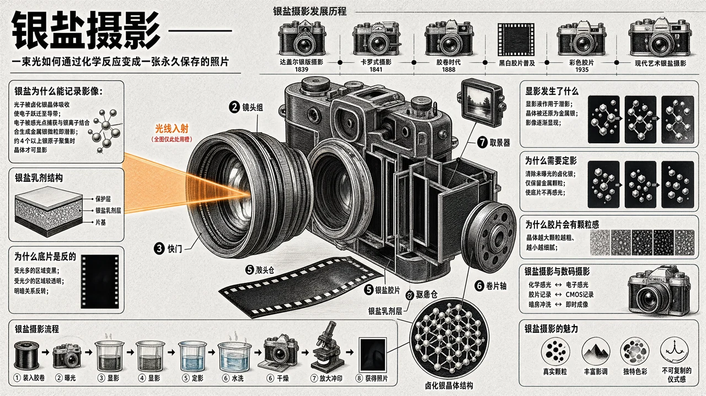
      </td>
    </tr>
    <tr>
      <td valign="top">
        

          
<b>高动态范围单板滑雪摄影</b>

          <pre><code>画面是一张方形极限运动摄影，陡峭雪坡从左下斜切到右上，形成强烈的动态构图。一名单板滑雪者位于画面偏左中部，被背后的太阳照成黑色剪影，身后扬起大片明亮粉雪。背景是浓郁深蓝色晴空，雪粒在逆光中像细密星点一样闪烁。右下方出现鲜艳的彩虹折射光带，与冷色雪景形成醒目的色彩对比。整体具有高速、冷冽、自由而震撼的户外运动海报质感。</code></pre>
        

      </td>
      <td valign="top" align="center">
        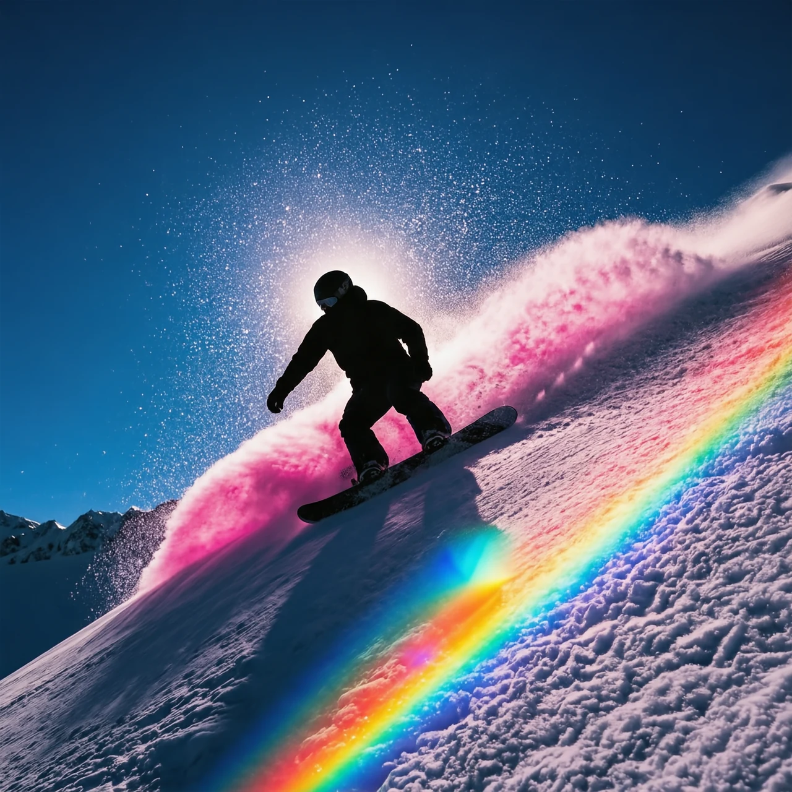
      </td>
    </tr>
  </tbody>
</table>

## 图像编辑

点击 Prompt 可展开全文；点击图片可查看原始分辨率。

<table>
  <thead>
    <tr>
      <th width="34%">提示词</th>
      <th width="33%">输入图像</th>
      <th width="33%">输出图像</th>
    </tr>
  </thead>
  <tbody>
    <tr>
      <td valign="top">
        

          
<b>参考图风格编辑</b>

          <pre><code>Create an infographic titled "The Journey of Postal Mail" using the watercolor illustration style of the reference image. The background should resemble textured paper with soft watercolor clouds, stars, and leafy plants in the corners.

Layout a winding beige path connecting four numbered milestones, starting with a wooden "START" arrow on the left and ending with a "DESTINATION" arrow on the bottom right.

1.  **Milestone 1 (Collection):** Place a purple circle marker with "1" and a wooden sign saying "Drop-off". Illustrate a sender placing a letter into a blue street mailbox or a post office counter. Add a text box titled "1. Collection" with a purple banner reading "First Step of the Journey". List details: "Action: Mailing", "Location: Local Post Box", "Handler: Postal Carrier".
2.  **Milestone 2 (Processing):** Place a blue circle marker with "2" and a sign saying "Sorting". Illustrate a mail sorting facility with conveyor belts and workers. Add a text box titled "2. Sorting Center" with a blue banner reading "Automated Distribution". List details: "Action: Sorting", "Location: Distribution Center", "Method: Zip Code".
3.  **Milestone 3 (Transport):** Place a green circle marker with "3" and a sign saying "Transit". Illustrate a mail truck driving on a highway or a cargo plane in the sky. Add a text box titled "3. Transportation" with a green banner reading "Cross-Country Travel". List details: "Action: Transport", "Location: Highway/Air", "Method: Truck/Plane".
4.  **Milestone 4 (Delivery):** Place a red circle marker with "4" and a sign saying "Delivery". Illustrate a mail carrier delivering a package to a house doorstep. Add a text box titled "4. Final Delivery" with a red banner reading "Arrival at Destination". List details: "Action: Delivery", "Location: Recipient Home", "Handler: Mail Carrier".

Use a dark blue brush-script font for the main title "The Journey of Postal Mail" at the top center. Ensure text boxes have rounded corners, colored borders matching their respective milestone markers, and small icons next to the list items (e.g., a location pin, a clock, a person icon).</code></pre>
        

      </td>
      <td align="center" valign="middle">
        <a href="./assets/showcases/editing/case1_postal_mail.webp">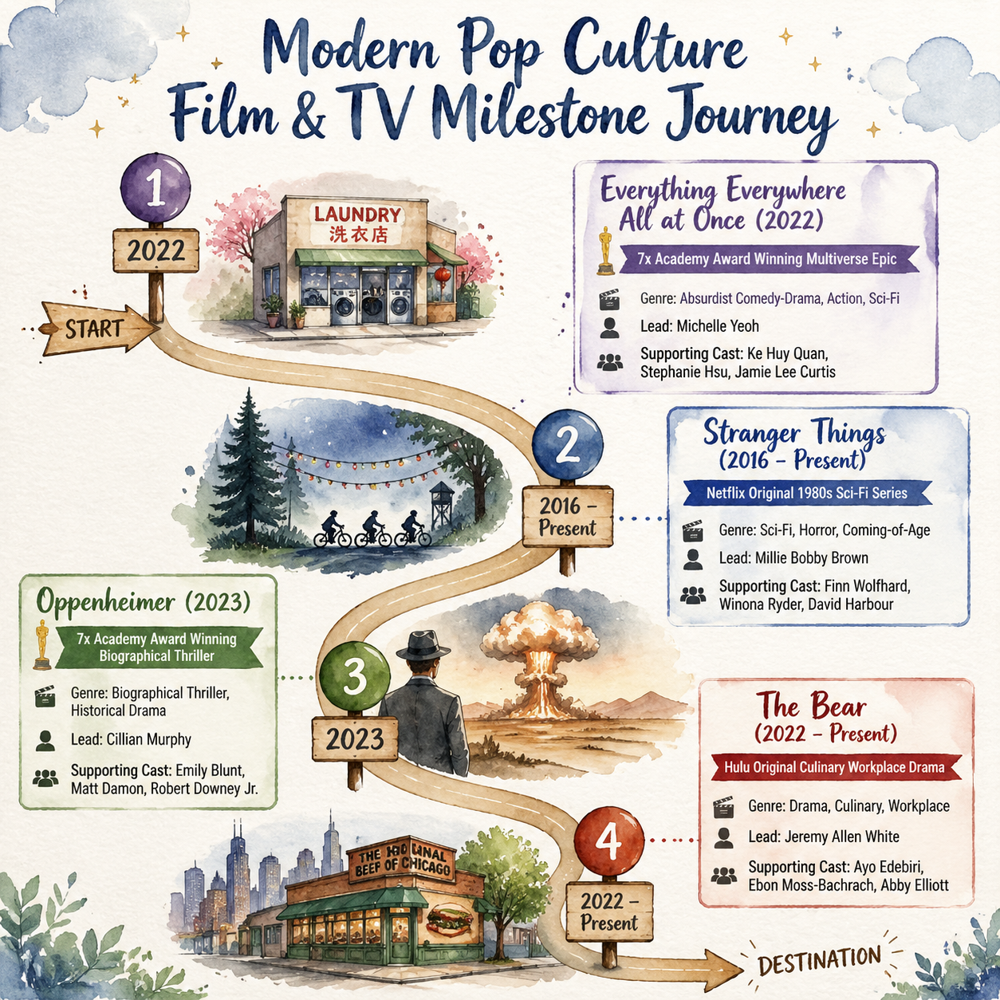</a>
      </td>
      <td align="center" valign="middle">
        <a href="./assets/showcases/editing_gallery/0001_2048x2048.webp">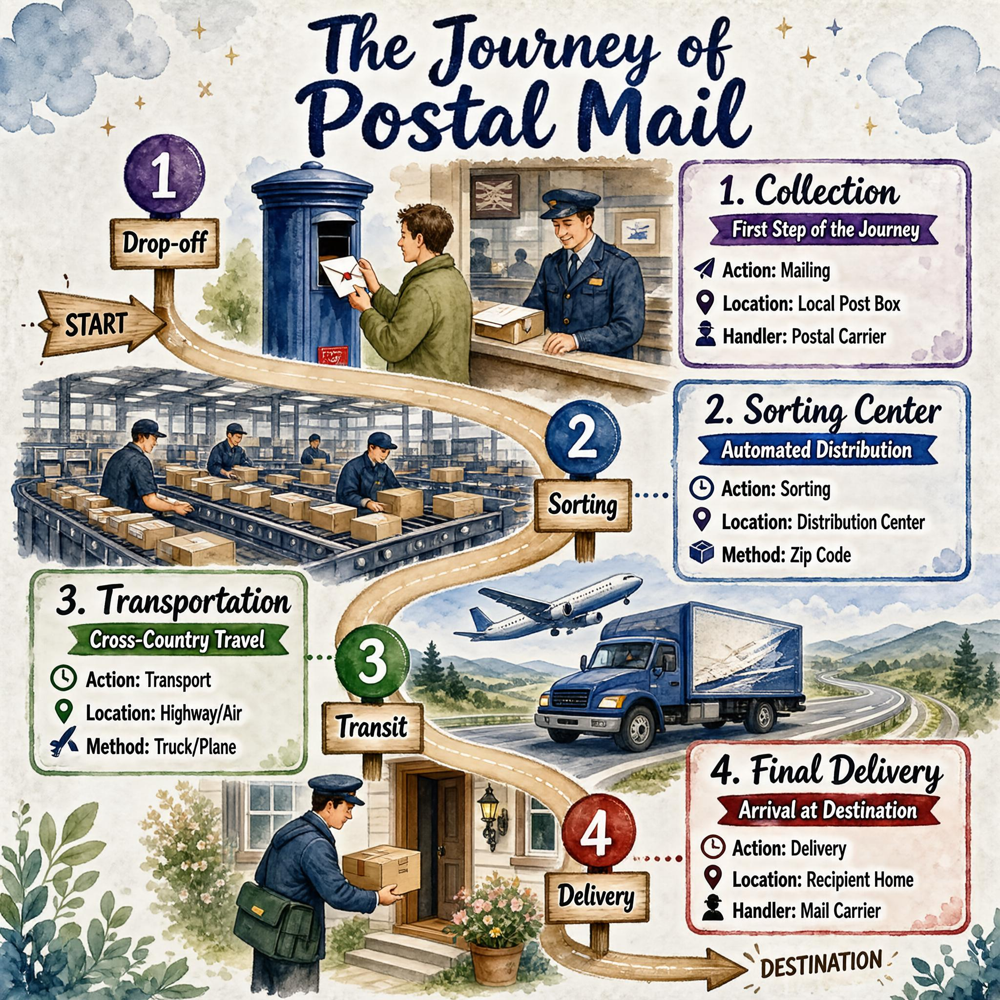</a>
      </td>
    </tr>
    <tr>
      <td valign="top">
        

          
<b>多参考图组合</b>

          <pre><code>将图像转换为手绘食谱插画风格，背景为米色网格笔记本纸张，左侧带有黑色螺旋装订线圈。

**顶部区域：**
- 大标题书写“韩式双拼炸鸡”，副标题为“外酥里嫩，快乐加倍的周末美食”。
- 右上角放置图2中的炸鸡成品大图（金属网篮装着原味炸鸡和裹着红色酱汁撒芝麻的炸鸡，旁边有一杯加冰可乐和一碟腌萝卜）。
- 左侧画一只可爱的粉色卡通小猪抱着红辣椒，旁边有一个米色信息框，写着：难度：★★★★☆，耗时：60分钟，口味：咸甜酥脆。

**主体步骤区域（2行3列布局）：**
1.  **步骤1 食材准备**：手绘鸡腿、面粉、鸡蛋、韩式辣酱等食材。文字说明：“鸡腿500g、面粉、淀粉、鸡蛋、牛奶、蒜末、韩式辣酱、蜂蜜”。
2.  **步骤2 腌制入味**：手绘碗中放入鸡腿和调料。文字说明：“鸡腿划刀，加入牛奶、蒜末、盐、黑胡椒，腌制30分钟”。
3.  **步骤3 裹粉挂糊**：手绘鸡腿裹粉过程。文字说明：“依次裹上淀粉、蛋液、混合粉（面粉:淀粉=1:1），捏出鳞片状”。
4.  **步骤4 第一次油炸**：手绘油锅炸鸡腿。文字说明：“油温160度，下入鸡腿中小火炸6分钟至熟透，捞出”。
5.  **步骤5 第二次复炸**：手绘油锅复炸。文字说明：“油温升至200度，复炸2分钟至金黄酥脆，捞出备用”。
6.  **步骤6 裹酱装盘**：手绘金属篮，一半炸鸡裹上红色甜辣酱撒白芝麻，一半保持原味。文字说明：“一半保持原味，另一半裹上甜辣酱（辣酱+蜂蜜+蒜末），撒芝麻，搭配可乐”。

**底部区域：**
- 底部有一个“小贴士”框，文字为：“复炸是酥脆的关键！甜辣酱比例可根据口味调整。”
- 右下角画一只竖大拇指的卡通小猪。

**整体要求：**
- 所有文字必须为清晰的中文，字体风格模仿手写体。
- 保持图1的温馨手绘色调，线条柔和，色彩丰富。</code></pre>
        

      </td>
      <td align="center" valign="middle">
        <a href="./assets/showcases/editing/case2_recipe_style_reference.webp">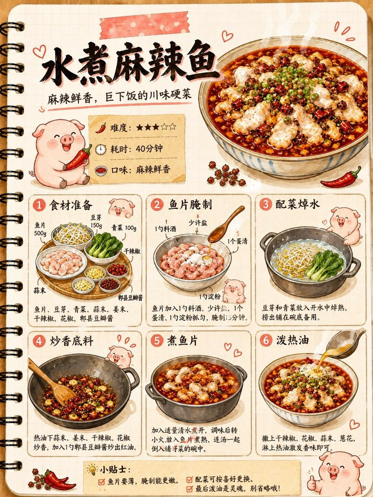</a>
        <a href="./assets/showcases/editing/case2_fried_chicken_reference.webp">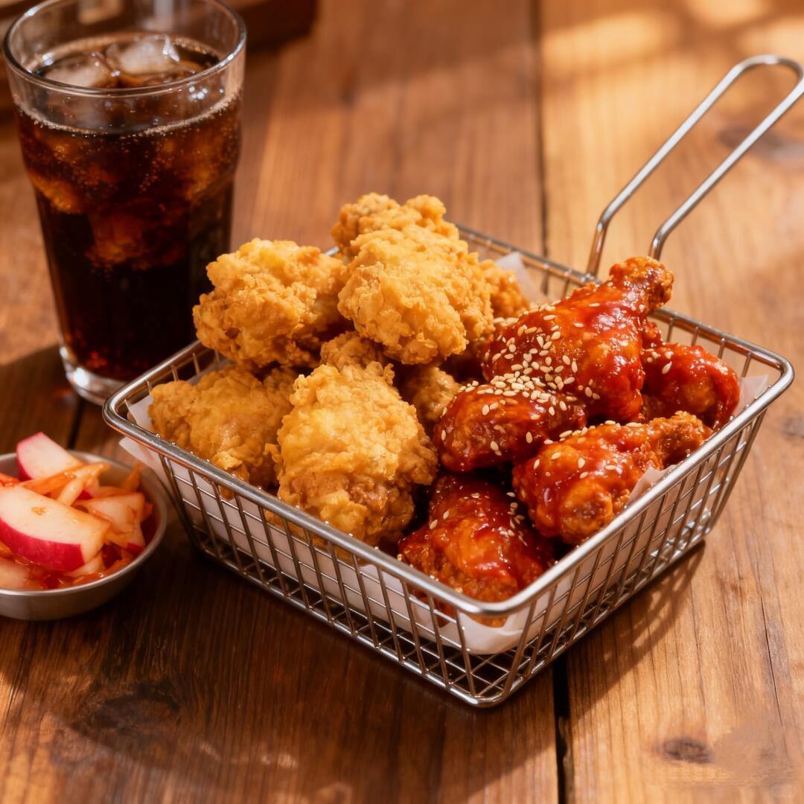</a>
      </td>
      <td align="center" valign="middle">
        <a href="./assets/showcases/editing_gallery/0002_1760x2336.webp">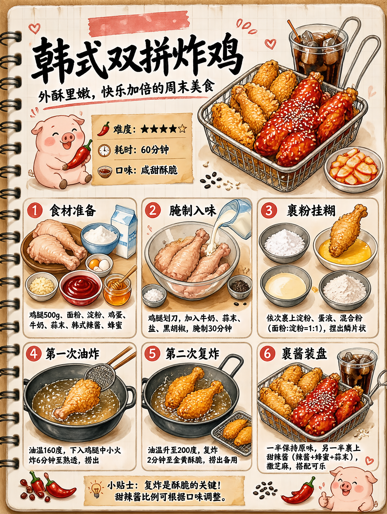</a>
      </td>
    </tr>
    <tr>
      <td valign="top">
        

          
<b>参考主体封面生成</b>

          <pre><code>Use the provided photo as the main subject reference: keep the young boy’s identity, cheerful smile, short black hair, raised flexing arm pose, and white cotton tank top. Create a Xiaohongshu cover design promoting kids’ cool summer cotton tank tops.

Design a vertical social-media cover with a bright, lively cartoon illustration style. Transform the photo into a clean, cute illustrated look while preserving the boy’s recognizable pose and outfit. Use a fresh summer palette with sky blue, white, lemon yellow, and light mint green. Add cute summer elements around him, such as small smiling suns, clouds, ice cubes, water splashes, tiny stars, and playful breeze lines. Keep the composition energetic and kid-friendly.

Place the boy as the central visual focus, slightly enlarged, with the raised fist near the upper-left area and the stretched tank top fabric visible at the lower-right. Use a simple illustrated summer background with soft gradients and rounded shapes.

Add the main title text "Summer Coolness" in large, bold, rounded cartoon lettering near the top center. Use bright blue or turquoise letters with a white outline and subtle shadow so it stands out clearly. Add smaller supporting text "Kids Cotton Tank Tops" below the title in a clean rounded font. Add a small badge or sticker near the side that says "Soft · Breathable · Cool" in readable text.

Make the final image look like a polished Xiaohongshu product cover: cute, clean, colorful, eye-catching, and suitable for promoting children’s summer clothing. Preserve the boy’s friendly expression and natural proportions. Avoid changing him into an adult, avoid adding unrelated products, and keep all text clear and correctly spelled.</code></pre>
        

      </td>
      <td align="center" valign="middle">
        
      </td>
      <td align="center" valign="middle">
        <a href="./assets/showcases/editing_gallery/0003_1792x2304.webp">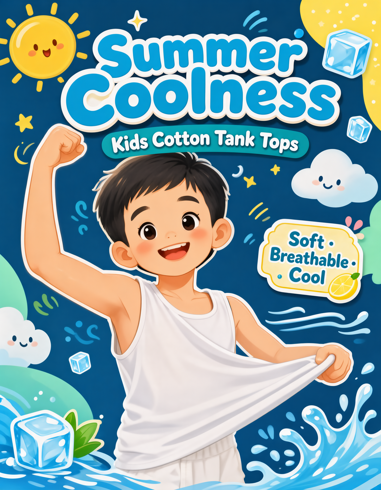</a>
      </td>
    </tr>
    <tr>
      <td valign="top">
        

          
<b>局部内容编辑</b>

          
将左侧蓝色主标题文字替换为“固定式储能用钠离子电池”。保持原海报的复古印刷质感、深蓝色窄体大字风格、粗细比例、字距、行距和左侧纵向排版占位不变，使中文标题在原标题区域内分行排列并保持强烈的竖向视觉节奏。保留除该主标题以外的所有文字、图表、图标、日期、插画、颜色、纹理和布局不变。

        

      </td>
      <td align="center" valign="middle">
        <a href="./assets/showcases/editing/case4_sodium_ion_battery_title.webp">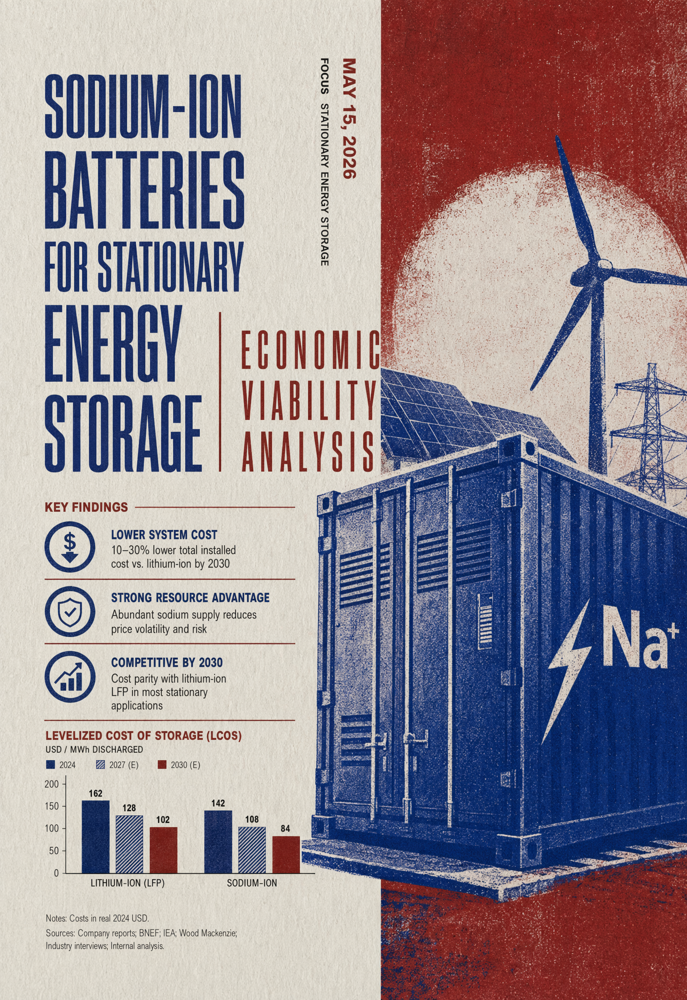</a>
      </td>
      <td align="center" valign="middle">
        <a href="./assets/showcases/editing_gallery/0004_1696x2432.webp">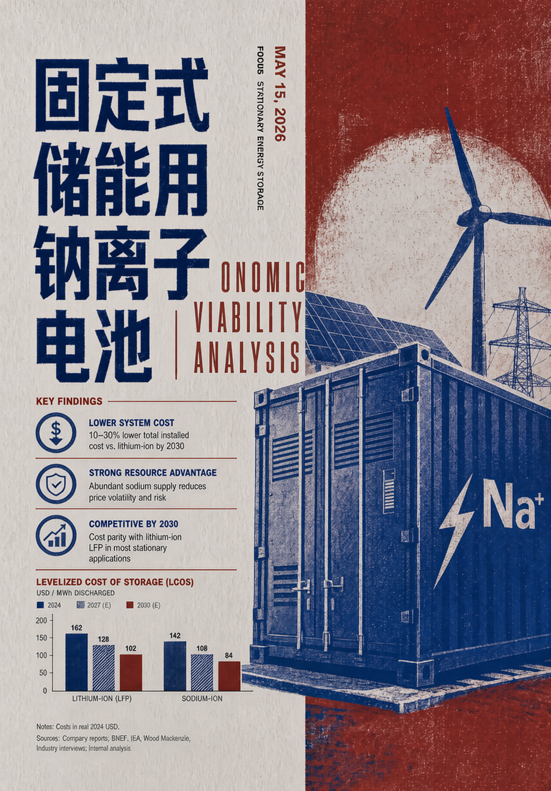</a>
      </td>
    </tr>
    <tr>
      <td valign="top">
        

          
<b>文字造型编辑</b>

          
以基础图片进行局部文字造型编辑。仅将画面中央由海浪翻涌轨迹与白色船只共同拼出的巨大中文字符“迎”替换为“命”，目标字符必须清晰可识别为“命”。保持原图俯拍海面视角、青绿色海水、白色浪花、船只航行、飞鸟、顶部手写英文文字、底部白色中文文字、整体构图和画面比例不变。新的“命”字仍需由自然翻涌的白色海浪、泡沫水纹和船只航行轨迹组成，浪花边缘与原图质感一致，具有真实海面流动感，不要做成平面字体或贴图效果。将“命”字的最后一竖设计为原有白色船只的纵向航行形态，船只位置、透视、大小和光影尽量沿用原图，只调整周围浪花与水纹，使其自然成为“命”字结构的一部分。除“迎”改为“命”这一目标区域外，其他所有文字、海面纹理、飞鸟数量与位置、船只主体质感、色彩、光照、留白和整体旅行海报风格均保持不变。避免生成乱码、额外文字、错误汉字、重复船只、变形船体、突兀浪花、风格不一致或大范围重绘背景。

        

      </td>
      <td align="center" valign="middle">
        <a href="./assets/showcases/editing/case5_ocean_wave_character_edit.webp">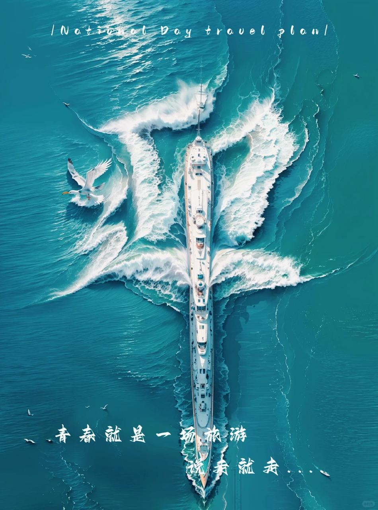</a>
      </td>
      <td align="center" valign="middle">
        <a href="./assets/showcases/editing_gallery/0005_1760x2368.webp">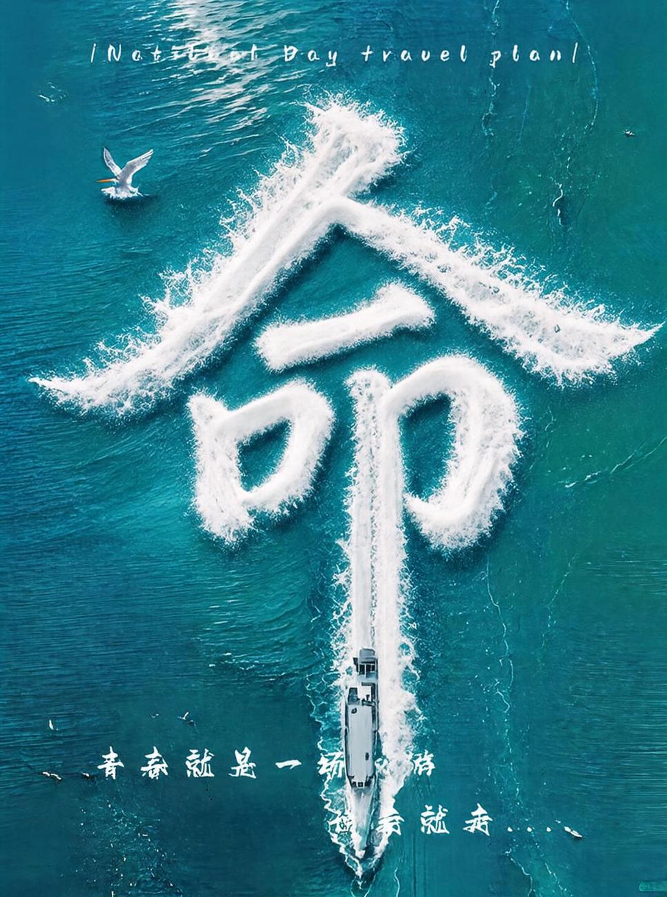</a>
      </td>
    </tr>
    <tr>
      <td valign="top">
        

          
<b>区域标注编辑</b>

          
将红框内的文本“05月06日 10:00-17:00”替换为“06月18日 09:00-18:00”。保持原有的绿色字体、粗体样式和两行排版（第一行为日期，第二行为时间），并移除红框。

        

      </td>
      <td align="center" valign="middle">
        <a href="./assets/showcases/editing/case6_event_date_replacement.webp">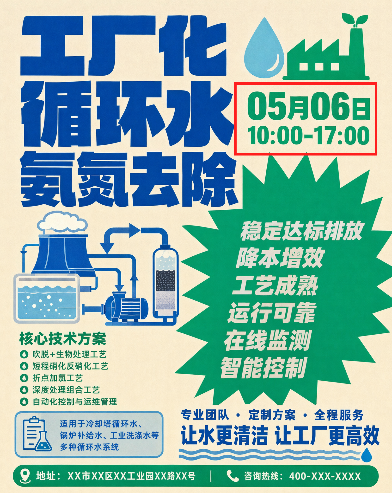</a>
      </td>
      <td align="center" valign="middle">
        <a href="./assets/showcases/editing_gallery/0006_1824x2272.webp">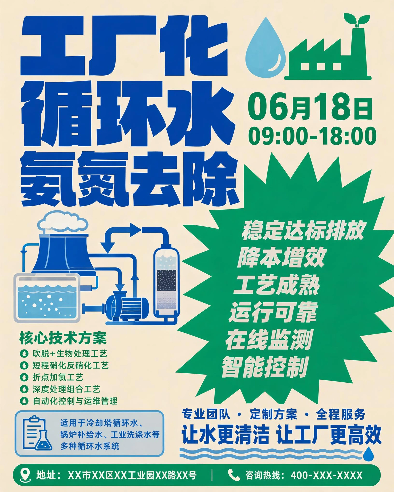</a>
      </td>
    </tr>
  </tbody>
</table>

## 提示词增强案例

这些案例随 U1.5 Preview 发布，用于展示可选的提示词预处理。原页面没有记录权重提交号和增强工具所用服务，因此只能作为效果示例，不能视为受控对比。工具用法见[U1.5 提示词增强](u1.5_best_practices_CN.md)；其中的运行示例使用当前 U1.5 权重。

### 参考图反推提示词

Caption 脚本从参考图提取可编辑的描述，示例输出见 [result.json](../src/sensenova_u1_5/caption/result.json)。

<table>
  <thead>
    <tr>
      <th width="25%" align="center">原图</th>
      <th width="25%" align="center">反推重建</th>
      <th width="25%" align="center">V0</th>
      <th width="25%" align="center">V1</th>
    </tr>
  </thead>
  <tbody>
    <tr>
      <td align="center" valign="top">
        <a href="../src/sensenova_u1_5/caption/img/origin.png">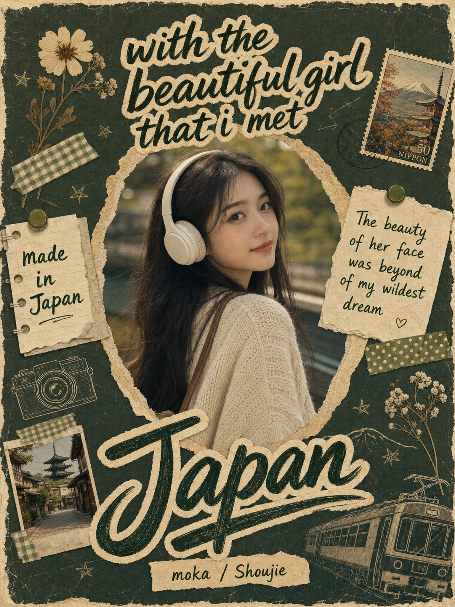</a>
      </td>
      <td align="center" valign="top">
        <a href="../src/sensenova_u1_5/caption/img/reversed.png">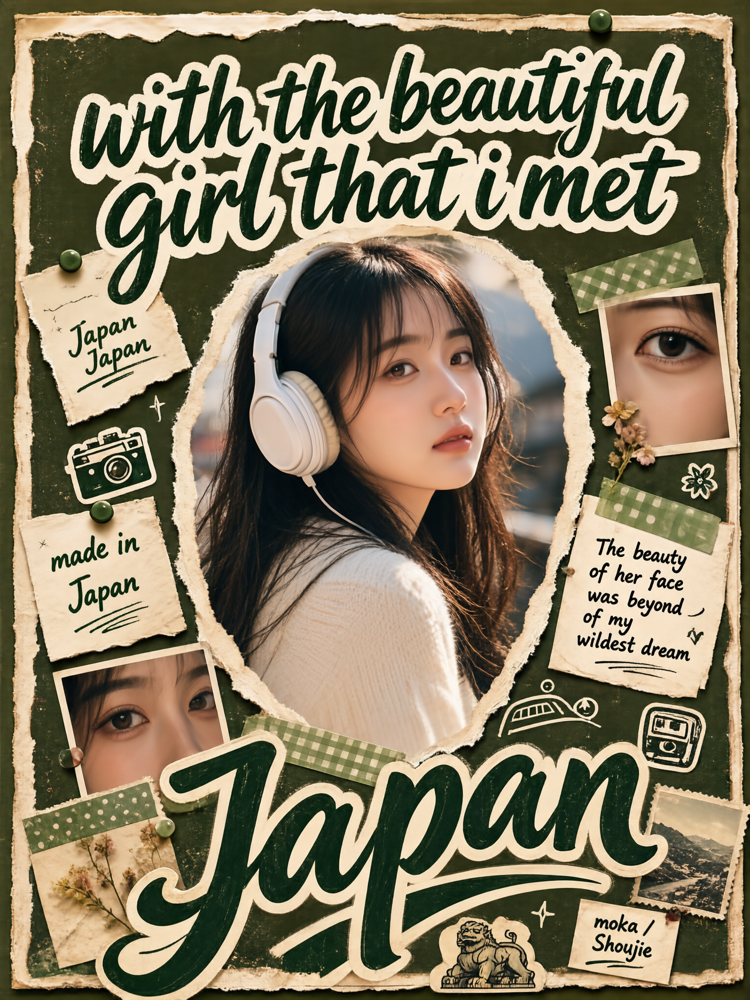</a>
      </td>
      <td align="center" valign="top">
        <a href="../src/sensenova_u1_5/caption/img/reversed_red.png">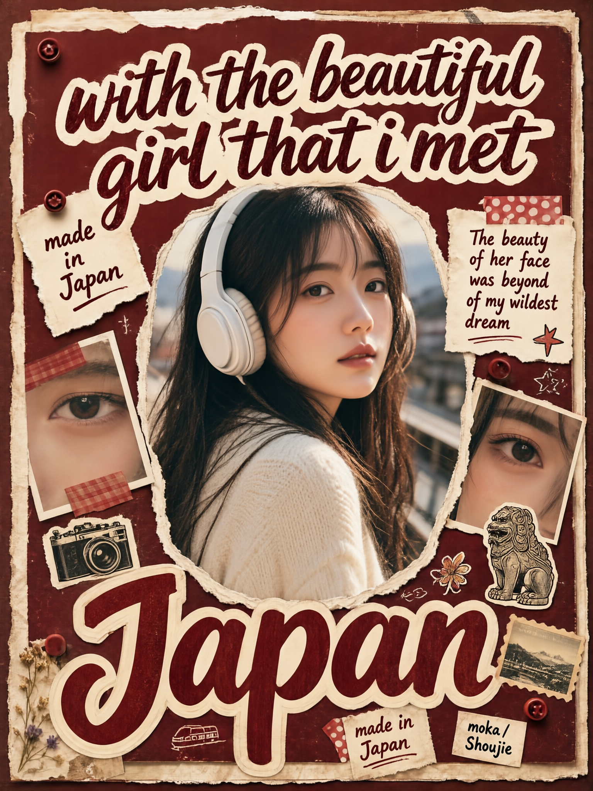</a>
      </td>
      <td align="center" valign="top">
        <a href="../src/sensenova_u1_5/caption/img/reversed_beijing.png">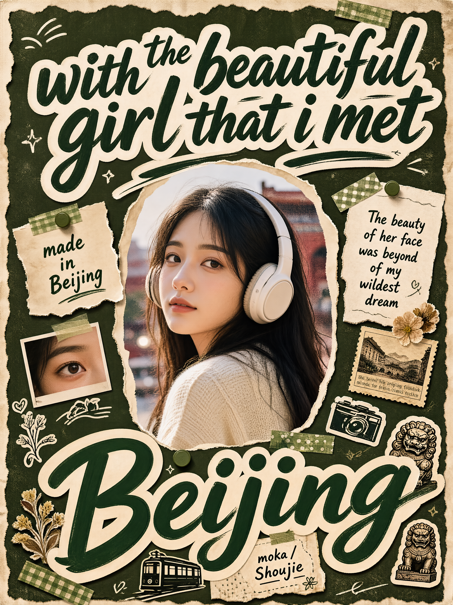</a>
      </td>
    </tr>
  </tbody>
</table>

### 编辑指令增强

同一张参考图分别使用原始提示词和增强后的提示词生成。

<table>
  <thead>
    <tr>
      <th width="20%" align="center">输入图像</th>
      <th width="20%" align="center">原始 Prompt</th>
      <th width="20%" align="center">原始 Prompt 输出</th>
      <th width="20%" align="center">PE 增强 Prompt</th>
      <th width="20%" align="center">PE 增强 Prompt 输出</th>
    </tr>
  </thead>
  <tbody>
    <tr>
      <td align="center" valign="top">
        <a href="./assets/showcases/editing_gallery/case1_ancient_roof_infographic.webp">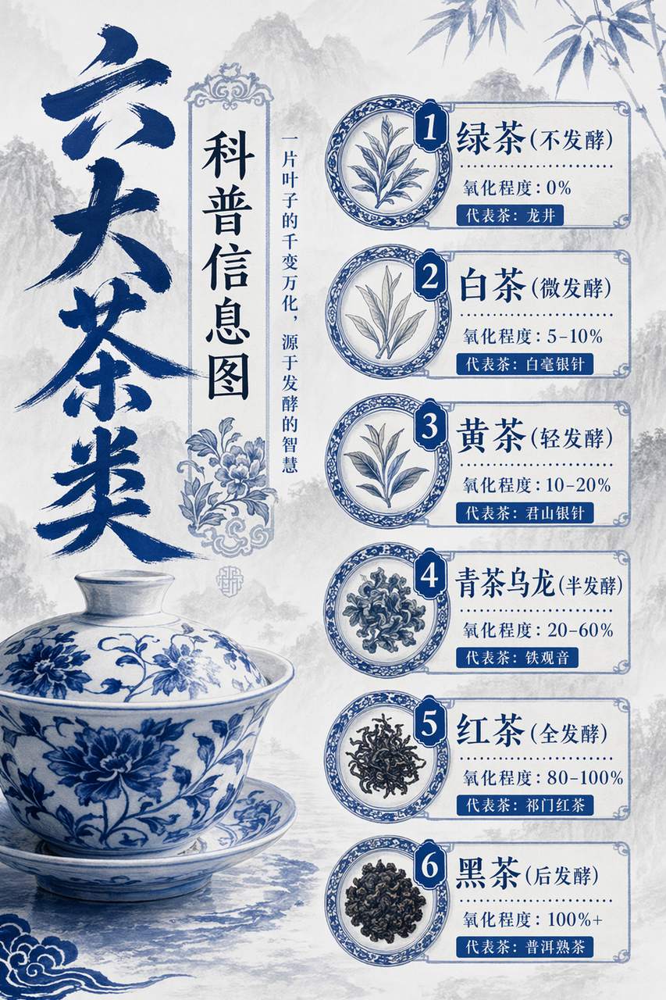</a>
      </td>
      <td valign="top">
        
参考这张图的青花水墨视觉语言，生成一张中国古建筑屋顶形制图鉴。

      </td>
      <td align="center" valign="top">
        <a href="./assets/showcases/editing_gallery/case1_edit_roof_no_pe_demo.webp">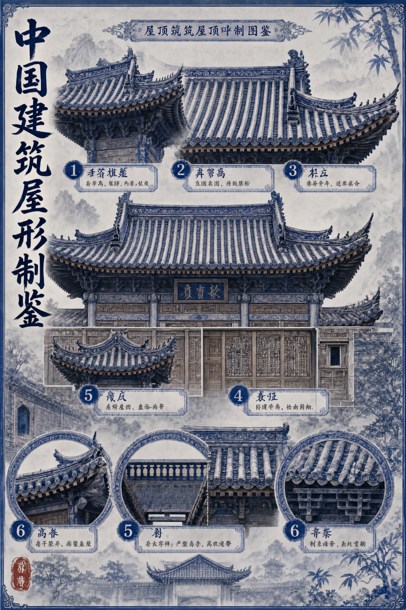</a>
      </td>
      <td valign="top">
        

          
<b>查看完整的 PE 增强 Prompt</b>

          
参考输入图的青花瓷与水墨视觉语言，生成一张竖版《中国古建筑屋顶形制图鉴》信息海报。整体使用白色宣纸背景、淡灰水墨山水远景、青花蓝单色主调、细腻瓷纹边框、传统卷草纹与云纹装饰，版式层级、圆形插图框、编号徽章、虚线分隔和说明卡片风格与参考图一致，但内容改为中国古建筑屋顶形制。

          
左侧设置大号竖排书法标题文字“屋顶形制”，使用深青蓝粗笔触。标题旁加入竖排副标题“飞檐斗拱之间，承载千年营造智慧”。左下角绘制一座青花瓷质感的古建筑屋脊与飞檐局部，带有花纹装饰和水墨阴影，替代参考图中的茶碗。背景保留淡雅山水、竹叶、云纹和留白感。

          
右侧从上到下排列 6 个屋顶形制条目，每个条目包含一个圆形青花瓷边框插图，里面用蓝灰线描绘对应屋顶轮廓；右侧连接一张青花边框信息卡。每张卡片包含编号、屋顶名称、简短特征和代表建筑，文字清晰可读，全部使用深青蓝色。

          
6 个条目的文字内容如下：

          <ol>
            <li>“庑殿顶” “等级：最高” “特征：四坡五脊，庄重宏阔” “代表：太和殿”</li>
            <li>“歇山顶” “等级：高” “特征：九脊结合，山花分明” “代表：故宫保和殿”</li>
            <li>“悬山顶” “等级：中” “特征：两坡出山墙，屋檩外挑” “代表：民居祠堂”</li>
            <li>“硬山顶” “等级：常见” “特征：两坡封山墙，朴素稳重” “代表：北方民居”</li>
            <li>“攒尖顶” “等级：亭阁常用” “特征：多坡汇于一点，形制挺拔” “代表：天坛祈年殿”</li>
            <li>“卷棚顶” “等级：园林常用” “特征：无正脊，曲线柔和” “代表：园林廊亭”</li>
          </ol>
          
保持整张海报为精致青花水墨插画风，避免现代图标和鲜艳颜色。构图清爽、对齐整齐、装饰细节丰富但不影响文字阅读。

        

      </td>
      <td align="center" valign="top">
        <a href="./assets/showcases/editing_gallery/case1_edit_roof_pe_demo.webp">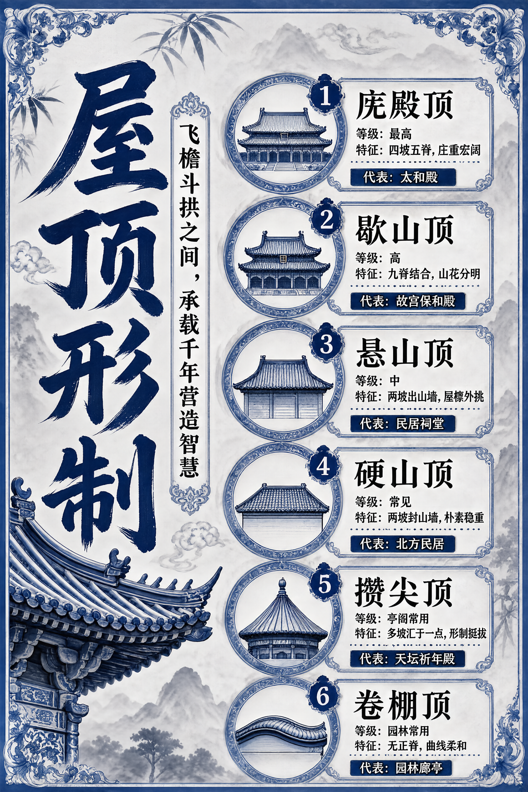</a>
      </td>
    </tr>
  </tbody>
</table>
