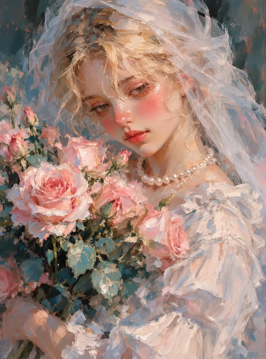
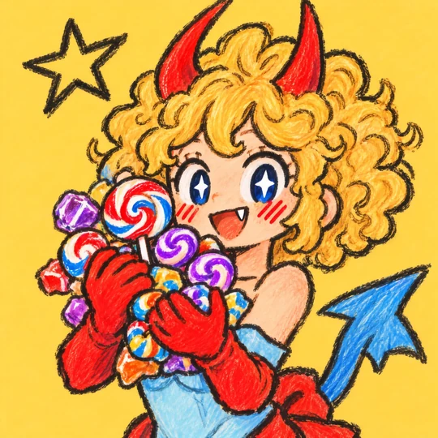
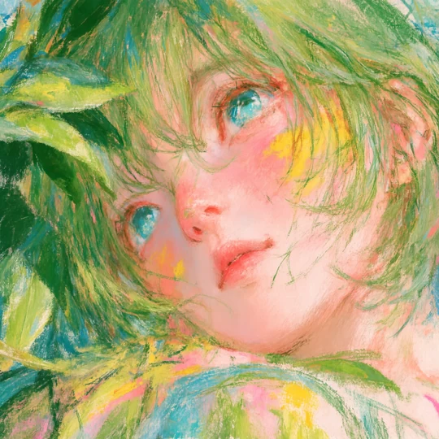

# SenseNova-U1.6 Showcases

<p align="center"><strong>English</strong> | <a href="./u1.6_showcases_CN.md">简体中文</a></p>

See the [U1.6 model guide](u1.6_model.md) for the supported workflows and local CLI examples.

<p align="center"><a href="#text-to-image">Text-to-Image</a> · <a href="#image-editing">Image Editing</a> · <a href="#self-correction">Self-Correction</a></p>

<a id="text-to-image"></a>

## Text-to-Image

<p align="center"><a href="#t2i-illustration">Illustration</a> · <a href="#t2i-portrait">Portrait</a> · <a href="#t2i-poster">Poster</a> · <a href="#t2i-infographic">Infographic</a> · <a href="#t2i-photography">Photography</a></p>

[Prompts](../examples/t2i/data/u1_6_gallery.jsonl)

<a id="t2i-illustration"></a>

### Illustration

<table width="100%">
  <tbody>
    <tr>
      <td width="33.33%" align="center" valign="top">
        <a href="https://huggingface.co/datasets/sensenova/SenseNova-U-showcases/resolve/18178639d32a935416e72eca87106cdcd3ee0af7/u1.6/t2i/pick-30.webp"></a>
      </td>
      <td width="33.33%" align="center" valign="top">
        <a href="https://huggingface.co/datasets/sensenova/SenseNova-U-showcases/resolve/18178639d32a935416e72eca87106cdcd3ee0af7/u1.6/t2i/pick-24.webp"></a>
      </td>
      <td width="33.33%" align="center" valign="top">
        <a href="https://huggingface.co/datasets/sensenova/SenseNova-U-showcases/resolve/18178639d32a935416e72eca87106cdcd3ee0af7/u1.6/t2i/pick-33.webp"></a>
      </td>
    </tr>
    <tr>
      <td width="33.33%" align="center"><sub><b>Eyes among Blue Flowers</b></sub></td>
      <td width="33.33%" align="center"><sub><b>Full Moon over Clouds</b></sub></td>
      <td width="33.33%" align="center"><sub><b>Flamingo Rider</b></sub></td>
    </tr>
    <tr>
      <td width="33.33%" align="center" valign="top">
        <a href="https://huggingface.co/datasets/sensenova/SenseNova-U-showcases/resolve/18178639d32a935416e72eca87106cdcd3ee0af7/u1.6/t2i/pick-25.webp"></a>
      </td>
      <td width="33.33%" align="center" valign="top">
        <a href="https://huggingface.co/datasets/sensenova/SenseNova-U-showcases/resolve/18178639d32a935416e72eca87106cdcd3ee0af7/u1.6/t2i/pick-26.webp"></a>
      </td>
      <td width="33.33%" align="center" valign="top">
        <a href="https://huggingface.co/datasets/sensenova/SenseNova-U-showcases/resolve/18178639d32a935416e72eca87106cdcd3ee0af7/u1.6/t2i/pick-28.webp"></a>
      </td>
    </tr>
    <tr>
      <td width="33.33%" align="center"><sub><b>Green Hills in the Wind</b></sub></td>
      <td width="33.33%" align="center"><sub><b>Watercolor Landscape and Birds</b></sub></td>
      <td width="33.33%" align="center"><sub><b>Girl and a Glowing Orb</b></sub></td>
    </tr>
    <tr>
      <td width="33.33%" align="center" valign="top">
        <a href="https://huggingface.co/datasets/sensenova/SenseNova-U-showcases/resolve/18178639d32a935416e72eca87106cdcd3ee0af7/u1.6/t2i/pick-29.webp"></a>
      </td>
      <td width="33.33%" align="center" valign="top">
        <a href="https://huggingface.co/datasets/sensenova/SenseNova-U-showcases/resolve/18178639d32a935416e72eca87106cdcd3ee0af7/u1.6/t2i/pick-31.webp"></a>
      </td>
      <td width="33.33%" align="center" valign="top">
        <a href="https://huggingface.co/datasets/sensenova/SenseNova-U-showcases/resolve/18178639d32a935416e72eca87106cdcd3ee0af7/u1.6/t2i/pick-35.webp"></a>
      </td>
    </tr>
    <tr>
      <td width="33.33%" align="center"><sub><b>Vintage Dream Valley</b></sub></td>
      <td width="33.33%" align="center"><sub><b>Girl beneath Lanterns</b></sub></td>
      <td width="33.33%" align="center"><sub><b>Pink Giant beyond the Grass Curtain</b></sub></td>
    </tr>
    <tr>
      <td width="33.33%" align="center" valign="top">
        <a href="https://huggingface.co/datasets/sensenova/SenseNova-U-showcases/resolve/18178639d32a935416e72eca87106cdcd3ee0af7/u1.6/t2i/curated-01.webp"></a>
      </td>
      <td width="33.33%" align="center" valign="top">
        <a href="https://huggingface.co/datasets/sensenova/SenseNova-U-showcases/resolve/18178639d32a935416e72eca87106cdcd3ee0af7/u1.6/t2i/curated-03.webp"></a>
      </td>
      <td width="33.33%" align="center" valign="top">
        <a href="https://huggingface.co/datasets/sensenova/SenseNova-U-showcases/resolve/18178639d32a935416e72eca87106cdcd3ee0af7/u1.6/t2i/curated-04.webp"></a>
      </td>
    </tr>
    <tr>
      <td width="33.33%" align="center"><sub><b>Ink-Wash Mountain Journey</b></sub></td>
      <td width="33.33%" align="center"><sub><b>Boy Surrounded by Cats</b></sub></td>
      <td width="33.33%" align="center"><sub><b>Figures at a Wall of Light</b></sub></td>
    </tr>
  </tbody>
</table>

<table width="100%">
  <tbody>
    <tr>
      <td width="50%" align="center" valign="top">
        <a href="https://huggingface.co/datasets/sensenova/SenseNova-U-showcases/resolve/18178639d32a935416e72eca87106cdcd3ee0af7/u1.6/t2i/curated-05.webp"></a>
      </td>
      <td width="50%" align="center" valign="top">
        <a href="https://huggingface.co/datasets/sensenova/SenseNova-U-showcases/resolve/18178639d32a935416e72eca87106cdcd3ee0af7/u1.6/t2i/pick-34.webp"></a>
      </td>
    </tr>
    <tr>
      <td width="50%" align="center"><sub><b>Lantern-Painting Girl</b></sub></td>
      <td width="50%" align="center"><sub><b>Lantern-Lit Fish Journey</b></sub></td>
    </tr>
    <tr>
      <td width="50%" align="center" valign="top">
        <a href="https://huggingface.co/datasets/sensenova/SenseNova-U-showcases/resolve/18178639d32a935416e72eca87106cdcd3ee0af7/u1.6/t2i/curated-02.webp"></a>
      </td>
      <td width="50%" align="center" valign="top">
        <a href="https://huggingface.co/datasets/sensenova/SenseNova-U-showcases/resolve/18178639d32a935416e72eca87106cdcd3ee0af7/u1.6/t2i/pick-32.webp"></a>
      </td>
    </tr>
    <tr>
      <td width="50%" align="center"><sub><b>Boy and White Dog in the Shade</b></sub></td>
      <td width="50%" align="center"><sub><b>Reading with a Giant Pink Cat</b></sub></td>
    </tr>
    <tr>
      <td width="50%" align="center" valign="top">
        <a href="https://huggingface.co/datasets/sensenova/SenseNova-U-showcases/resolve/18178639d32a935416e72eca87106cdcd3ee0af7/u1.6/t2i/pick-36.webp"></a>
      </td>
      <td width="50%" align="center" valign="top">
        <a href="https://huggingface.co/datasets/sensenova/SenseNova-U-showcases/resolve/18178639d32a935416e72eca87106cdcd3ee0af7/u1.6/t2i/pick-27.webp"></a>
      </td>
    </tr>
    <tr>
      <td width="50%" align="center"><sub><b>Giraffes beyond the Arch of Light</b></sub></td>
      <td width="50%" align="center"><sub><b>Pavilions under the Moon</b></sub></td>
    </tr>
  </tbody>
</table>

<a id="t2i-portrait"></a>

### Portrait

<table width="100%">
  <tbody>
    <tr>
      <td width="33.33%" align="center" valign="top">
        <a href="https://huggingface.co/datasets/sensenova/SenseNova-U-showcases/resolve/18178639d32a935416e72eca87106cdcd3ee0af7/u1.6/t2i/curated-10.webp"></a>
      </td>
      <td width="33.33%" align="center" valign="top">
        <a href="https://huggingface.co/datasets/sensenova/SenseNova-U-showcases/resolve/18178639d32a935416e72eca87106cdcd3ee0af7/u1.6/t2i/pick-06.webp"></a>
      </td>
      <td width="33.33%" align="center" valign="top">
        <a href="https://huggingface.co/datasets/sensenova/SenseNova-U-showcases/resolve/18178639d32a935416e72eca87106cdcd3ee0af7/u1.6/t2i/pick-07.webp"></a>
      </td>
    </tr>
    <tr>
      <td width="33.33%" align="center"><sub><b>Silver-Haired Man and Mirrored Sculpture</b></sub></td>
      <td width="33.33%" align="center"><sub><b>Running with Yellow Flowers</b></sub></td>
      <td width="33.33%" align="center"><sub><b>Pink Glasses from Above</b></sub></td>
    </tr>
    <tr>
      <td width="33.33%" align="center" valign="top">
        <a href="https://huggingface.co/datasets/sensenova/SenseNova-U-showcases/resolve/18178639d32a935416e72eca87106cdcd3ee0af7/u1.6/t2i/curated-07.webp"></a>
      </td>
      <td width="33.33%" align="center" valign="top">
        <a href="https://huggingface.co/datasets/sensenova/SenseNova-U-showcases/resolve/18178639d32a935416e72eca87106cdcd3ee0af7/u1.6/t2i/curated-08.webp"></a>
      </td>
      <td width="33.33%" align="center" valign="top">
        <a href="https://huggingface.co/datasets/sensenova/SenseNova-U-showcases/resolve/18178639d32a935416e72eca87106cdcd3ee0af7/u1.6/t2i/pick-02.webp"></a>
      </td>
    </tr>
    <tr>
      <td width="33.33%" align="center"><sub><b>Man Smelling Flowers under a Blue Sky</b></sub></td>
      <td width="33.33%" align="center"><sub><b>Jewelry Art Portrait</b></sub></td>
      <td width="33.33%" align="center"><sub><b>Portrait with Transparent Flowers</b></sub></td>
    </tr>
  </tbody>
</table>

<table width="100%">
  <tbody>
    <tr>
      <td width="50%" align="center" valign="top">
        <a href="https://huggingface.co/datasets/sensenova/SenseNova-U-showcases/resolve/18178639d32a935416e72eca87106cdcd3ee0af7/u1.6/t2i/pick-05.webp"></a>
      </td>
      <td width="50%" align="center" valign="top">
        <a href="https://huggingface.co/datasets/sensenova/SenseNova-U-showcases/resolve/18178639d32a935416e72eca87106cdcd3ee0af7/u1.6/t2i/pick-08.webp"></a>
      </td>
    </tr>
    <tr>
      <td width="50%" align="center"><sub><b>Flowers in Motion</b></sub></td>
      <td width="50%" align="center"><sub><b>Looking Back in Warm Light</b></sub></td>
    </tr>
    <tr>
      <td width="50%" align="center" valign="top">
        <a href="https://huggingface.co/datasets/sensenova/SenseNova-U-showcases/resolve/18178639d32a935416e72eca87106cdcd3ee0af7/u1.6/t2i/curated-06.webp"></a>
      </td>
      <td width="50%" align="center" valign="top">
        <a href="https://huggingface.co/datasets/sensenova/SenseNova-U-showcases/resolve/18178639d32a935416e72eca87106cdcd3ee0af7/u1.6/t2i/pick-10.webp"></a>
      </td>
    </tr>
    <tr>
      <td width="50%" align="center"><sub><b>A Game of Cards at the Bar</b></sub></td>
      <td width="50%" align="center"><sub><b>By a Red Sports Car</b></sub></td>
    </tr>
    <tr>
      <td width="50%" align="center" valign="top">
        <a href="https://huggingface.co/datasets/sensenova/SenseNova-U-showcases/resolve/18178639d32a935416e72eca87106cdcd3ee0af7/u1.6/t2i/pick-11.webp"></a>
      </td>
      <td width="50%" align="center" valign="top">
        <a href="https://huggingface.co/datasets/sensenova/SenseNova-U-showcases/resolve/18178639d32a935416e72eca87106cdcd3ee0af7/u1.6/t2i/pick-01.webp"></a>
      </td>
    </tr>
    <tr>
      <td width="50%" align="center"><sub><b>Black Dress among Poppies</b></sub></td>
      <td width="50%" align="center"><sub><b>Red Flowers by a Passing Train</b></sub></td>
    </tr>
  </tbody>
</table>

<a id="t2i-poster"></a>

### Poster

<table width="100%">
  <tbody>
    <tr>
      <td width="33.33%" align="center" valign="top">
        <a href="https://huggingface.co/datasets/sensenova/SenseNova-U-showcases/resolve/18178639d32a935416e72eca87106cdcd3ee0af7/u1.6/t2i/pick-18.webp"></a>
      </td>
      <td width="33.33%" align="center" valign="top">
        <a href="https://huggingface.co/datasets/sensenova/SenseNova-U-showcases/resolve/18178639d32a935416e72eca87106cdcd3ee0af7/u1.6/t2i/curated-12.webp"></a>
      </td>
      <td width="33.33%" align="center" valign="top">
        <a href="https://huggingface.co/datasets/sensenova/SenseNova-U-showcases/resolve/18178639d32a935416e72eca87106cdcd3ee0af7/u1.6/t2i/curated-14.webp"></a>
      </td>
    </tr>
    <tr>
      <td width="33.33%" align="center"><sub><b>Ocean Surfing</b></sub></td>
      <td width="33.33%" align="center"><sub><b>Live a More Natural Life</b></sub></td>
      <td width="33.33%" align="center"><sub><b>Bauhaus Architecture</b></sub></td>
    </tr>
    <tr>
      <td width="33.33%" align="center" valign="top">
        <a href="https://huggingface.co/datasets/sensenova/SenseNova-U-showcases/resolve/18178639d32a935416e72eca87106cdcd3ee0af7/u1.6/t2i/pick-20.webp"></a>
      </td>
      <td width="33.33%" align="center" valign="top">
        <a href="https://huggingface.co/datasets/sensenova/SenseNova-U-showcases/resolve/18178639d32a935416e72eca87106cdcd3ee0af7/u1.6/t2i/curated-11.webp"></a>
      </td>
      <td width="33.33%" align="center" valign="top">
        <a href="https://huggingface.co/datasets/sensenova/SenseNova-U-showcases/resolve/18178639d32a935416e72eca87106cdcd3ee0af7/u1.6/t2i/curated-13.webp"></a>
      </td>
    </tr>
    <tr>
      <td width="33.33%" align="center"><sub><b>Jasmine and Grape Dessert</b></sub></td>
      <td width="33.33%" align="center"><sub><b>HUSH Floral Poster</b></sub></td>
      <td width="33.33%" align="center"><sub><b>Bless You</b></sub></td>
    </tr>
    <tr>
      <td width="33.33%" align="center" valign="top">
        <a href="https://huggingface.co/datasets/sensenova/SenseNova-U-showcases/resolve/18178639d32a935416e72eca87106cdcd3ee0af7/u1.6/t2i/curated-15.webp"></a>
      </td>
      <td width="33.33%" align="center" valign="top">
        <a href="https://huggingface.co/datasets/sensenova/SenseNova-U-showcases/resolve/18178639d32a935416e72eca87106cdcd3ee0af7/u1.6/t2i/pick-19.webp"></a>
      </td>
      <td width="33.33%" align="center" valign="top">
        <a href="https://huggingface.co/datasets/sensenova/SenseNova-U-showcases/resolve/18178639d32a935416e72eca87106cdcd3ee0af7/u1.6/t2i/pick-22.webp"></a>
      </td>
    </tr>
    <tr>
      <td width="33.33%" align="center"><sub><b>It Will Eventually Become Nothing</b></sub></td>
      <td width="33.33%" align="center"><sub><b>Apple Mouse</b></sub></td>
      <td width="33.33%" align="center"><sub><b>Iridescent Metal Rose</b></sub></td>
    </tr>
    <tr>
      <td width="33.33%" align="center" valign="top">
        <a href="https://huggingface.co/datasets/sensenova/SenseNova-U-showcases/resolve/18178639d32a935416e72eca87106cdcd3ee0af7/u1.6/t2i/pick-23.webp"></a>
      </td>
      <td width="33.33%" align="center" valign="top">
        <a href="https://huggingface.co/datasets/sensenova/SenseNova-U-showcases/resolve/18178639d32a935416e72eca87106cdcd3ee0af7/u1.6/t2i/pick-13.webp"></a>
      </td>
      <td width="33.33%" align="center" valign="top">
        <a href="https://huggingface.co/datasets/sensenova/SenseNova-U-showcases/resolve/18178639d32a935416e72eca87106cdcd3ee0af7/u1.6/t2i/pick-14.webp"></a>
      </td>
    </tr>
    <tr>
      <td width="33.33%" align="center"><sub><b>DREAM Velvet Hills</b></sub></td>
      <td width="33.33%" align="center"><sub><b>Life in Bloom</b></sub></td>
      <td width="33.33%" align="center"><sub><b>Portrait with Orange Light Trails</b></sub></td>
    </tr>
  </tbody>
</table>

<table width="100%">
  <tbody>
    <tr>
      <td width="25%" align="center" valign="top">
        <a href="https://huggingface.co/datasets/sensenova/SenseNova-U-showcases/resolve/18178639d32a935416e72eca87106cdcd3ee0af7/u1.6/t2i/pick-15.webp"></a>
      </td>
      <td width="25%" align="center" valign="top">
        <a href="https://huggingface.co/datasets/sensenova/SenseNova-U-showcases/resolve/18178639d32a935416e72eca87106cdcd3ee0af7/u1.6/t2i/pick-16.webp"></a>
      </td>
      <td width="25%" align="center" valign="top">
        <a href="https://huggingface.co/datasets/sensenova/SenseNova-U-showcases/resolve/18178639d32a935416e72eca87106cdcd3ee0af7/u1.6/t2i/pick-17.webp"></a>
      </td>
      <td width="25%" align="center" valign="top">
        <a href="https://huggingface.co/datasets/sensenova/SenseNova-U-showcases/resolve/18178639d32a935416e72eca87106cdcd3ee0af7/u1.6/t2i/pick-21.webp"></a>
      </td>
    </tr>
    <tr>
      <td width="25%" align="center"><sub><b>SHANGHAI City Fantasy</b></sub></td>
      <td width="25%" align="center"><sub><b>Summer Wheat Field</b></sub></td>
      <td width="25%" align="center"><sub><b>Hello Summer</b></sub></td>
      <td width="25%" align="center"><sub><b>Good Ingredients Baking</b></sub></td>
    </tr>
  </tbody>
</table>

<a id="t2i-infographic"></a>

### Infographic

<table width="100%">
  <tbody>
    <tr>
      <td width="25%" align="center" valign="top">
        <a href="https://huggingface.co/datasets/sensenova/SenseNova-U-showcases/resolve/18178639d32a935416e72eca87106cdcd3ee0af7/u1.6/t2i/curated-18.webp"></a>
      </td>
      <td width="25%" align="center" valign="top">
        <a href="https://huggingface.co/datasets/sensenova/SenseNova-U-showcases/resolve/18178639d32a935416e72eca87106cdcd3ee0af7/u1.6/t2i/curated-19.webp"></a>
      </td>
      <td width="25%" align="center" valign="top">
        <a href="https://huggingface.co/datasets/sensenova/SenseNova-U-showcases/resolve/18178639d32a935416e72eca87106cdcd3ee0af7/u1.6/t2i/curated-16.webp"></a>
      </td>
      <td width="25%" align="center" valign="top">
        <a href="https://huggingface.co/datasets/sensenova/SenseNova-U-showcases/resolve/18178639d32a935416e72eca87106cdcd3ee0af7/u1.6/t2i/curated-17.webp"></a>
      </td>
    </tr>
    <tr>
      <td width="25%" align="center"><sub><b>History of the Internal Combustion Engine</b></sub></td>
      <td width="25%" align="center"><sub><b>Hyperion Space Shuttle</b></sub></td>
      <td width="25%" align="center"><sub><b>Movement Defines Us</b></sub></td>
      <td width="25%" align="center"><sub><b>Precision Anti-Wrinkle</b></sub></td>
    </tr>
  </tbody>
</table>

<a id="t2i-photography"></a>

### Photography

<table width="100%">
  <tbody>
    <tr>
      <td width="25%" align="center" valign="top">
        <a href="https://huggingface.co/datasets/sensenova/SenseNova-U-showcases/resolve/18178639d32a935416e72eca87106cdcd3ee0af7/u1.6/t2i/photo-selected-02.webp"></a>
      </td>
      <td width="25%" align="center" valign="top">
        <a href="https://huggingface.co/datasets/sensenova/SenseNova-U-showcases/resolve/18178639d32a935416e72eca87106cdcd3ee0af7/u1.6/t2i/photo-selected-01.webp"></a>
      </td>
      <td width="25%" align="center" valign="top">
        <a href="https://huggingface.co/datasets/sensenova/SenseNova-U-showcases/resolve/18178639d32a935416e72eca87106cdcd3ee0af7/u1.6/t2i/photo-selected-03.webp"></a>
      </td>
      <td width="25%" align="center" valign="top">
        <a href="https://huggingface.co/datasets/sensenova/SenseNova-U-showcases/resolve/18178639d32a935416e72eca87106cdcd3ee0af7/u1.6/t2i/photo-selected-05.webp"></a>
      </td>
    </tr>
    <tr>
      <td width="25%" align="center"><sub><b>City Crossroads</b></sub></td>
      <td width="25%" align="center"><sub><b>White Cat among Gold Foil</b></sub></td>
      <td width="25%" align="center"><sub><b>Deer at a Wooden Window</b></sub></td>
      <td width="25%" align="center"><sub><b>Sequined Dress after the Party</b></sub></td>
    </tr>
  </tbody>
</table>

<a id="image-editing"></a>

## Image Editing

<p align="center"><a href="#edit-illustration">Illustration</a> · <a href="#edit-portrait">Portrait</a> · <a href="#edit-poster">Poster</a></p>

[Prompts](../examples/editing/data/sample_edit_u16_gallery.jsonl)

Before passing the JSONL file to the editing CLI, run this command from the repository root to download its 12 input images (about 24 MiB).

```bash
hf download sensenova/SenseNova-U-showcases --repo-type dataset \
  --revision 18178639d32a935416e72eca87106cdcd3ee0af7 \
  --include 'u1.6/editing/*-input.*' --local-dir .cache/sensenova-u-showcases
```

<a id="edit-illustration"></a>

### Illustration

<table width="100%">
  <thead>
    <tr>
      <th width="25%">Input</th>
      <th width="25%">Edited</th>
      <th width="25%">Input</th>
      <th width="25%">Edited</th>
    </tr>
  </thead>
  <tbody>
    <tr>
      <td width="25%" align="center" valign="top">
        <a href="https://huggingface.co/datasets/sensenova/SenseNova-U-showcases/resolve/18178639d32a935416e72eca87106cdcd3ee0af7/u1.6/editing/illustration-03-input.png"></a>
      </td>
      <td width="25%" align="center" valign="top">
        <a href="https://huggingface.co/datasets/sensenova/SenseNova-U-showcases/resolve/18178639d32a935416e72eca87106cdcd3ee0af7/u1.6/editing/illustration-03-output.jpg"></a>
      </td>
      <td width="25%" align="center" valign="top">
        <a href="https://huggingface.co/datasets/sensenova/SenseNova-U-showcases/resolve/18178639d32a935416e72eca87106cdcd3ee0af7/u1.6/editing/illustration-14-input.png"></a>
      </td>
      <td width="25%" align="center" valign="top">
        <a href="https://huggingface.co/datasets/sensenova/SenseNova-U-showcases/resolve/18178639d32a935416e72eca87106cdcd3ee0af7/u1.6/editing/illustration-14-output.jpg"></a>
      </td>
    </tr>
    <tr>
      <td colspan="2" width="50%" align="center" valign="top">
        <sub><b>Coat color and fabric</b></sub>
        <details>
          <summary>Edit prompt</summary>
          <p align="left">保留原图男子的脸部身份、青绿色眼睛、正面站姿、半身构图、领巾和复古数字插画质感。只把深蓝色外套改成深森林绿色的粗纺羊毛外套，保留白色荷叶边衬衫和金色细节。不要改变面部、发型、姿势、背景几何或画幅。</p>
        </details>
      </td>
      <td colspan="2" width="50%" align="center" valign="top">
        <sub><b>Roses to hydrangeas</b></sub>
        <details>
          <summary>Edit prompt</summary>
          <p align="left">保留原图金发少女的脸部身份、灰白薄纱、低头看花的姿态、白色荷叶边上衣、珍珠项链、厚涂油画质感和近距离构图。只把怀中的粉色玫瑰改成淡蓝色绣球花，保留花束遮挡胸部和手部的关系。不要改变人物、薄纱透明度、姿势、光线方向或背景色块。</p>
        </details>
      </td>
    </tr>
    <tr>
      <td width="25%" align="center" valign="top">
        <a href="https://huggingface.co/datasets/sensenova/SenseNova-U-showcases/resolve/18178639d32a935416e72eca87106cdcd3ee0af7/u1.6/editing/illustration-13-input.png"></a>
      </td>
      <td width="25%" align="center" valign="top">
        <a href="https://huggingface.co/datasets/sensenova/SenseNova-U-showcases/resolve/18178639d32a935416e72eca87106cdcd3ee0af7/u1.6/editing/illustration-13-output.jpg"></a>
      </td>
      <td width="25%" align="center" valign="top">
        <a href="https://huggingface.co/datasets/sensenova/SenseNova-U-showcases/resolve/18178639d32a935416e72eca87106cdcd3ee0af7/u1.6/editing/illustration-15-input.png"></a>
      </td>
      <td width="25%" align="center" valign="top">
        <a href="https://huggingface.co/datasets/sensenova/SenseNova-U-showcases/resolve/18178639d32a935416e72eca87106cdcd3ee0af7/u1.6/editing/illustration-15-output.jpg"></a>
      </td>
    </tr>
    <tr>
      <td colspan="2" width="50%" align="center" valign="top">
        <sub><b>Candy to a glowing lantern</b></sub>
        <details>
          <summary>Edit prompt</summary>
          <p align="left">保留原图卷发少女的脸部、弯曲小角、糖果动作、Q版比例、黄色背景和日系手绘线条。只把怀中的糖果改成一盏小型发光纸灯笼，灯笼发出暖橙色光，照亮手部和下巴。不要改变角色身份、发型、姿势、角的位置、背景色或构图。</p>
        </details>
      </td>
      <td colspan="2" width="50%" align="center" valign="top">
        <sub><b>Lavender highlights and raindrops</b></sub>
        <details>
          <summary>Edit prompt</summary>
          <p align="left">保留原图年轻女性的脸部、草绿色短发、青蓝色眼睛、粉彩和油画棒的粗粝颗粒、近距离构图以及左侧遮挡脸部的深绿色叶片。只把发丝中的草绿色高光改成柔和的薰衣草紫，并在发梢和叶片边缘加入少量雨滴。不要改变五官、视线、发型轮廓、叶片位置、背景或裁切。</p>
        </details>
      </td>
    </tr>
  </tbody>
</table>

<a id="edit-portrait"></a>

### Portrait

<table width="100%">
  <thead>
    <tr>
      <th width="25%">Input</th>
      <th width="25%">Edited</th>
      <th width="25%">Input</th>
      <th width="25%">Edited</th>
    </tr>
  </thead>
  <tbody>
    <tr>
      <td width="25%" align="center" valign="top">
        <a href="https://huggingface.co/datasets/sensenova/SenseNova-U-showcases/resolve/18178639d32a935416e72eca87106cdcd3ee0af7/u1.6/editing/portrait-02-input.png"></a>
      </td>
      <td width="25%" align="center" valign="top">
        <a href="https://huggingface.co/datasets/sensenova/SenseNova-U-showcases/resolve/18178639d32a935416e72eca87106cdcd3ee0af7/u1.6/editing/portrait-02-output.jpg"></a>
      </td>
      <td width="25%" align="center" valign="top">
        <a href="https://huggingface.co/datasets/sensenova/SenseNova-U-showcases/resolve/18178639d32a935416e72eca87106cdcd3ee0af7/u1.6/editing/portrait-03-input.png"></a>
      </td>
      <td width="25%" align="center" valign="top">
        <a href="https://huggingface.co/datasets/sensenova/SenseNova-U-showcases/resolve/18178639d32a935416e72eca87106cdcd3ee0af7/u1.6/editing/portrait-03-output.jpg"></a>
      </td>
    </tr>
    <tr>
      <td colspan="2" width="50%" align="center" valign="top">
        <sub><b>Orchid to gerbera</b></sub>
        <details>
          <summary>Edit prompt</summary>
          <p align="left">将遮住右眼的深紫兰花改成亮橙色非洲菊，保持雀斑、另一只眼、亮唇、白背景与3:4构图不变。</p>
        </details>
      </td>
      <td colspan="2" width="50%" align="center" valign="top">
        <sub><b>Velvet hat and brick-red lips</b></sub>
        <details>
          <summary>Edit prompt</summary>
          <p align="left">将暗红帽子改成墨绿色天鹅绒，并将唇色改为砖红色，保持人物、眼妆、视线与2:3近摄不变。</p>
        </details>
      </td>
    </tr>
    <tr>
      <td width="25%" align="center" valign="top">
        <a href="https://huggingface.co/datasets/sensenova/SenseNova-U-showcases/resolve/18178639d32a935416e72eca87106cdcd3ee0af7/u1.6/editing/portrait-05-input.png"></a>
      </td>
      <td width="25%" align="center" valign="top">
        <a href="https://huggingface.co/datasets/sensenova/SenseNova-U-showcases/resolve/18178639d32a935416e72eca87106cdcd3ee0af7/u1.6/editing/portrait-05-output.jpg"></a>
      </td>
      <td width="25%" align="center" valign="top">
        <a href="https://huggingface.co/datasets/sensenova/SenseNova-U-showcases/resolve/18178639d32a935416e72eca87106cdcd3ee0af7/u1.6/editing/portrait-06-input.png"></a>
      </td>
      <td width="25%" align="center" valign="top">
        <a href="https://huggingface.co/datasets/sensenova/SenseNova-U-showcases/resolve/18178639d32a935416e72eca87106cdcd3ee0af7/u1.6/editing/portrait-06-output.jpg"></a>
      </td>
    </tr>
    <tr>
      <td colspan="2" width="50%" align="center" valign="top">
        <sub><b>Burgundy backdrop and tulip</b></sub>
        <details>
          <summary>Edit prompt</summary>
          <p align="left">将背景蓝色渐变改成深酒红到黑色渐变，并将遮眼花改成淡黄色郁金香，保持复古高盘发、人物比例与3:4不变。</p>
        </details>
      </td>
      <td colspan="2" width="50%" align="center" valign="top">
        <sub><b>Satin to deep blue velvet</b></sub>
        <details>
          <summary>Edit prompt</summary>
          <p align="left">将绿色缎面抹胸改成深蓝色丝绒，保持黑短卷发、奶白头带、低垂侧脸、绿珠项链与3:4不变。</p>
        </details>
      </td>
    </tr>
  </tbody>
</table>

<a id="edit-poster"></a>

### Poster

<table width="100%">
  <thead>
    <tr>
      <th width="25%">Input</th>
      <th width="25%">Edited</th>
      <th width="25%">Input</th>
      <th width="25%">Edited</th>
    </tr>
  </thead>
  <tbody>
    <tr>
      <td width="25%" align="center" valign="top">
        <a href="https://huggingface.co/datasets/sensenova/SenseNova-U-showcases/resolve/18178639d32a935416e72eca87106cdcd3ee0af7/u1.6/editing/poster-01-input.jpg"></a>
      </td>
      <td width="25%" align="center" valign="top">
        <a href="https://huggingface.co/datasets/sensenova/SenseNova-U-showcases/resolve/18178639d32a935416e72eca87106cdcd3ee0af7/u1.6/editing/poster-01-output.jpg"></a>
      </td>
      <td width="25%" align="center" valign="top">
        <a href="https://huggingface.co/datasets/sensenova/SenseNova-U-showcases/resolve/18178639d32a935416e72eca87106cdcd3ee0af7/u1.6/editing/poster-03-input.jpg"></a>
      </td>
      <td width="25%" align="center" valign="top">
        <a href="https://huggingface.co/datasets/sensenova/SenseNova-U-showcases/resolve/18178639d32a935416e72eca87106cdcd3ee0af7/u1.6/editing/poster-03-output.jpg"></a>
      </td>
    </tr>
    <tr>
      <td colspan="2" width="50%" align="center" valign="top">
        <sub><b>Headline replacement</b></sub>
        <details>
          <summary>Edit prompt</summary>
          <p align="left">把画面上方、粉色条纹猫背上方的绿色大字「RELAX」改成「PAUSE」。沿用原字的粗重手绘笔触、绿色、字高和单行排布，把五个字母放回原来的标题区域，与猫尾和猫耳留出原有的空隙。保留黑色底、粉猫、猫腿间的「NOTHING IS UNDER CONTROL」和右下角签名，保持原图比例。</p>
        </details>
      </td>
      <td colspan="2" width="50%" align="center" valign="top">
        <sub><b>Brown bear to red panda</b></sub>
        <details>
          <summary>Edit prompt</summary>
          <p align="left">把画面中央闭着眼的棕熊换成一只同样闭眼、头朝右的小熊猫，画出红褐色毛发、白色眉斑和白色口鼻。让它戴着原图同款黑色头戴式耳机，耳罩贴合头部，保留头梁形状和耳罩上的标识。延续原来的半身取景、柔光和浅灰背景，保留上方产品名、下方白色 JBL 标识及其他排版，保持原图比例。</p>
        </details>
      </td>
    </tr>
    <tr>
      <td width="25%" align="center" valign="top">
        <a href="https://huggingface.co/datasets/sensenova/SenseNova-U-showcases/resolve/18178639d32a935416e72eca87106cdcd3ee0af7/u1.6/editing/poster-06-input.jpg"></a>
      </td>
      <td width="25%" align="center" valign="top">
        <a href="https://huggingface.co/datasets/sensenova/SenseNova-U-showcases/resolve/18178639d32a935416e72eca87106cdcd3ee0af7/u1.6/editing/poster-06-output.jpg"></a>
      </td>
      <td width="25%" align="center" valign="top">
        <a href="https://huggingface.co/datasets/sensenova/SenseNova-U-showcases/resolve/18178639d32a935416e72eca87106cdcd3ee0af7/u1.6/editing/poster-10-input.jpg"></a>
      </td>
      <td width="25%" align="center" valign="top">
        <a href="https://huggingface.co/datasets/sensenova/SenseNova-U-showcases/resolve/18178639d32a935416e72eca87106cdcd3ee0af7/u1.6/editing/poster-10-output.jpg"></a>
      </td>
    </tr>
    <tr>
      <td colspan="2" width="50%" align="center" valign="top">
        <sub><b>Plush toy to glazed ceramic</b></sub>
        <details>
          <summary>Edit prompt</summary>
          <p align="left">把画面中间的绿色毛绒鳄鱼改成手捏上釉陶偶。保留原来的胖脸、凸眼、露齿和吐舌表情，并用彩釉还原原本的绿身、米白嘴、粉舌和橙色项圈。用微微不齐的捏塑边缘、釉面高光和轻微开片体现陶土材质。保留蓝底、顶部「CROCODILE」、日期和右下独立的黄色笑脸贴纸，保持原图构图和比例。</p>
        </details>
      </td>
      <td colspan="2" width="50%" align="center" valign="top">
        <sub><b>Warm red to cool blue lighting</b></sub>
        <details>
          <summary>Edit prompt</summary>
          <p align="left">把红色鸡尾酒海报的红色背景光改成深靛蓝到冰蓝的渐变，让冷蓝边光沿原杯缘、杯脚和桌面反射出现。保留杯中宝石红酒液和冰块，保留原有的星芒位置与「Ruby Sparkle」铜金色标题，确保左右小字和 7.24 日期在新背景上仍清楚。维持原有机位、玻璃杯形状、版式和比例。</p>
        </details>
      </td>
    </tr>
  </tbody>
</table>

<a id="self-correction"></a>

## Self-Correction

[Prompt & critique](../examples/interleave/data/prompt&critique.jsonl)

<table width="100%">
  <tbody>
    <tr>
      <td width="50%" align="center">
        <a href="https://huggingface.co/datasets/sensenova/SenseNova-U-showcases/resolve/18178639d32a935416e72eca87106cdcd3ee0af7/u1.6/videos/en/correction-poster.mp4"></a>
      </td>
      <td width="50%" align="center">
        <a href="https://huggingface.co/datasets/sensenova/SenseNova-U-showcases/resolve/18178639d32a935416e72eca87106cdcd3ee0af7/u1.6/videos/en/correction-strawberry_23.mp4"></a>
      </td>
    </tr>
    <tr>
      <td width="50%" align="center" valign="top">
        <a href="https://huggingface.co/datasets/sensenova/SenseNova-U-showcases/resolve/18178639d32a935416e72eca87106cdcd3ee0af7/u1.6/videos/en/correction-poster.mp4">▶ Vintage Movie Poster</a>
      </td>
      <td width="50%" align="center" valign="top">
        <a href="https://huggingface.co/datasets/sensenova/SenseNova-U-showcases/resolve/18178639d32a935416e72eca87106cdcd3ee0af7/u1.6/videos/en/correction-strawberry_23.mp4">▶ Strawberry Season</a>
      </td>
    </tr>
  </tbody>
</table>

<table width="100%">
  <thead>
    <tr>
      <th width="25%">Before Correction</th>
      <th width="25%">After Self-Correction</th>
      <th width="25%">Before Correction</th>
      <th width="25%">After Self-Correction</th>
    </tr>
  </thead>
  <tbody>
    <tr>
      <td width="25%" align="center" valign="top">
        <a href="https://huggingface.co/datasets/sensenova/SenseNova-U-showcases/resolve/18178639d32a935416e72eca87106cdcd3ee0af7/u1.6/self-correction/compare-2-before.webp"></a>
      </td>
      <td width="25%" align="center" valign="top">
        <a href="https://huggingface.co/datasets/sensenova/SenseNova-U-showcases/resolve/18178639d32a935416e72eca87106cdcd3ee0af7/u1.6/self-correction/compare-2-after.webp"></a>
      </td>
      <td width="25%" align="center" valign="top">
        <a href="https://huggingface.co/datasets/sensenova/SenseNova-U-showcases/resolve/18178639d32a935416e72eca87106cdcd3ee0af7/u1.6/self-correction/compare-3-before.webp"></a>
      </td>
      <td width="25%" align="center" valign="top">
        <a href="https://huggingface.co/datasets/sensenova/SenseNova-U-showcases/resolve/18178639d32a935416e72eca87106cdcd3ee0af7/u1.6/self-correction/compare-3-after.webp"></a>
      </td>
    </tr>
    <tr>
      <td colspan="2" width="50%" align="center" valign="top">
        <sub><b>Sakura Floral Poster</b></sub>
        <details>
          <summary>Native self-correction critique</summary>
          <p align="left">把下方[238, 878, 772, 896]内的“but it<br>
became an official national symbol in he<br>
”改为“but it became an official national<br>
symbol in the”、把下方[238, 898, 778,<br>
915]内的“early 20th century, around 1...</p>
        </details>
      </td>
      <td colspan="2" width="50%" align="center" valign="top">
        <sub><b>SOUL Music Poster</b></sub>
        <details>
          <summary>Native self-correction critique</summary>
          <p align="left">把中部[214, 452, 548, 467]内的“MEMORY<br>
SWAPPED FOR S ERENITY”改为“MEMORY<br>
SWAPPED FOR SERENITY”、把下方[440, 764,<br>
801, 780]内的“BETTER THERE IS LIGHTNESS<br>
AND”改为“BETTER THERE IS LIGHTNESS AN...</p>
        </details>
      </td>
    </tr>
    <tr>
      <td width="25%" align="center" valign="top">
        <a href="https://huggingface.co/datasets/sensenova/SenseNova-U-showcases/resolve/18178639d32a935416e72eca87106cdcd3ee0af7/u1.6/self-correction/compare-5-before.webp"></a>
      </td>
      <td width="25%" align="center" valign="top">
        <a href="https://huggingface.co/datasets/sensenova/SenseNova-U-showcases/resolve/18178639d32a935416e72eca87106cdcd3ee0af7/u1.6/self-correction/compare-5-after.webp"></a>
      </td>
      <td width="25%" align="center" valign="top">
        <a href="https://huggingface.co/datasets/sensenova/SenseNova-U-showcases/resolve/18178639d32a935416e72eca87106cdcd3ee0af7/u1.6/self-correction/compare-10-before.webp"></a>
      </td>
      <td width="25%" align="center" valign="top">
        <a href="https://huggingface.co/datasets/sensenova/SenseNova-U-showcases/resolve/18178639d32a935416e72eca87106cdcd3ee0af7/u1.6/self-correction/compare-10-after.webp"></a>
      </td>
    </tr>
    <tr>
      <td colspan="2" width="50%" align="center" valign="top">
        <sub><b>Jalopy Vintage Racing</b></sub>
        <details>
          <summary>Native self-correction critique</summary>
          <p align="left">把下方[304, 976, 942, 990]内的“cetar:<br>
EtberCoruvGral:ffaxdionenmnaos bay Ger<br>
Peters - www.DutchCourageGraffix.com”改<br>
为“© Ger Peters - www.<br>
DutchCourageGraffix.com”。</p>
        </details>
      </td>
      <td colspan="2" width="50%" align="center" valign="top">
        <sub><b>Chinese Streetwear Poster</b></sub>
        <details>
          <summary>Native self-correction critique</summary>
          <p align="left">把右上角[790, 70, 976, 82]内的“义义的碰<br>
撞。在废墟中”改为“义的碰撞。在废墟中”、<br>
把右上角[790, 86, 892, 97]内的“寻找秩序”<br>
改为“寻找秩序，”、把左上角[36, 236, 166,<br>
247]内的“二川丽植植做用”改为“小时植物...</p>
        </details>
      </td>
    </tr>
    <tr>
      <td width="25%" align="center" valign="top">
        <a href="https://huggingface.co/datasets/sensenova/SenseNova-U-showcases/resolve/18178639d32a935416e72eca87106cdcd3ee0af7/u1.6/self-correction/compare-587-before.webp"></a>
      </td>
      <td width="25%" align="center" valign="top">
        <a href="https://huggingface.co/datasets/sensenova/SenseNova-U-showcases/resolve/18178639d32a935416e72eca87106cdcd3ee0af7/u1.6/self-correction/compare-587-after.webp"></a>
      </td>
      <td width="25%" align="center" valign="top">
        <a href="https://huggingface.co/datasets/sensenova/SenseNova-U-showcases/resolve/18178639d32a935416e72eca87106cdcd3ee0af7/u1.6/self-correction/compare-790-before.webp"></a>
      </td>
      <td width="25%" align="center" valign="top">
        <a href="https://huggingface.co/datasets/sensenova/SenseNova-U-showcases/resolve/18178639d32a935416e72eca87106cdcd3ee0af7/u1.6/self-correction/compare-790-after.webp"></a>
      </td>
    </tr>
    <tr>
      <td colspan="2" width="50%" align="center" valign="top">
        <sub><b>Pet Poster on Red</b></sub>
        <details>
          <summary>Native self-correction critique</summary>
          <p align="left">去掉左下角[32, 836, 274, 844]内多余的“<br>
Dnilámoog3adg, aent b rastetceet to<br>
vmotn”、去掉左下角[32, 846, 294, 854]内<br>
多余的“adslionoos labdsoho tana6ostfpi<br>
lomzarte”、去掉左下角[28, 856, 294, 8...</p>
        </details>
      </td>
      <td colspan="2" width="50%" align="center" valign="top">
        <sub><b>Retro Ramune Soda</b></sub>
        <details>
          <summary>Native self-correction critique</summary>
          <p align="left">把左上角[48, 38, 314, 76]内的“昭契女り一<br>
”改为“昭和の味”。</p>
        </details>
      </td>
    </tr>
    <tr>
      <td width="25%" align="center" valign="top">
        <a href="https://huggingface.co/datasets/sensenova/SenseNova-U-showcases/resolve/18178639d32a935416e72eca87106cdcd3ee0af7/u1.6/self-correction/compare-873-before.webp"></a>
      </td>
      <td width="25%" align="center" valign="top">
        <a href="https://huggingface.co/datasets/sensenova/SenseNova-U-showcases/resolve/18178639d32a935416e72eca87106cdcd3ee0af7/u1.6/self-correction/compare-873-after.webp"></a>
      </td>
      <td width="25%" align="center" valign="top">
        <a href="https://huggingface.co/datasets/sensenova/SenseNova-U-showcases/resolve/18178639d32a935416e72eca87106cdcd3ee0af7/u1.6/self-correction/compare-1704-before.webp"></a>
      </td>
      <td width="25%" align="center" valign="top">
        <a href="https://huggingface.co/datasets/sensenova/SenseNova-U-showcases/resolve/18178639d32a935416e72eca87106cdcd3ee0af7/u1.6/self-correction/compare-1704-after.webp"></a>
      </td>
    </tr>
    <tr>
      <td colspan="2" width="50%" align="center" valign="top">
        <sub><b>The American Weekly Cover</b></sub>
        <details>
          <summary>Native self-correction critique</summary>
          <p align="left">去掉右上角[744, 126, 979, 138]内多余的“<br>
BRVS by MOEAV)500. USBUDC”。</p>
        </details>
      </td>
      <td colspan="2" width="50%" align="center" valign="top">
        <sub><b>LOVE Floral Poster</b></sub>
        <details>
          <summary>Native self-correction critique</summary>
          <p align="left">去掉左下角[56, 819, 474, 844]内多余的“<br>
mtmsooseí arutraviceation s”、去掉左下角<br>
[56, 850, 552, 874]内多余的“suls for<br>
oetiom fevlafjovvz aboning”、去掉左下角[<br>
56, 879, 563, 904]内多余的“...</p>
        </details>
      </td>
    </tr>
    <tr>
      <td width="25%" align="center" valign="top">
        <a href="https://huggingface.co/datasets/sensenova/SenseNova-U-showcases/resolve/18178639d32a935416e72eca87106cdcd3ee0af7/u1.6/self-correction/compare-3127-before.webp"></a>
      </td>
      <td width="25%" align="center" valign="top">
        <a href="https://huggingface.co/datasets/sensenova/SenseNova-U-showcases/resolve/18178639d32a935416e72eca87106cdcd3ee0af7/u1.6/self-correction/compare-3127-after.webp"></a>
      </td>
      <td width="25%" align="center" valign="top">
        <a href="https://huggingface.co/datasets/sensenova/SenseNova-U-showcases/resolve/18178639d32a935416e72eca87106cdcd3ee0af7/u1.6/self-correction/compare-3585-before.webp"></a>
      </td>
      <td width="25%" align="center" valign="top">
        <a href="https://huggingface.co/datasets/sensenova/SenseNova-U-showcases/resolve/18178639d32a935416e72eca87106cdcd3ee0af7/u1.6/self-correction/compare-3585-after.webp"></a>
      </td>
    </tr>
    <tr>
      <td colspan="2" width="50%" align="center" valign="top">
        <sub><b>Naive Design Flowers</b></sub>
        <details>
          <summary>Native self-correction critique</summary>
          <p align="left">去掉左侧[82, 574, 271, 586]内多余的“evre<br>
tnsstution has brams”、去掉左侧[82, 590,<br>
306, 602]内多余的“embracest reoatect<br>
ampoas”、去掉左侧[82, 606, 336, 618]内多<br>
余的“patems thelviaurs. fired unvclus...</p>
        </details>
      </td>
      <td colspan="2" width="50%" align="center" valign="top">
        <sub><b>Retro Cola Collage</b></sub>
        <details>
          <summary>Native self-correction critique</summary>
          <p align="left">把中部[544, 634, 674, 678]内的“12 / 1EE<br>
IFOZ”改为“12 FL OZ”。</p>
        </details>
      </td>
    </tr>
    <tr>
      <td width="25%" align="center" valign="top">
        <a href="https://huggingface.co/datasets/sensenova/SenseNova-U-showcases/resolve/18178639d32a935416e72eca87106cdcd3ee0af7/u1.6/self-correction/compare-3230-before.webp"></a>
      </td>
      <td width="25%" align="center" valign="top">
        <a href="https://huggingface.co/datasets/sensenova/SenseNova-U-showcases/resolve/18178639d32a935416e72eca87106cdcd3ee0af7/u1.6/self-correction/compare-3230-after.webp"></a>
      </td>
      <td width="25%" align="center" valign="top">
        <a href="https://huggingface.co/datasets/sensenova/SenseNova-U-showcases/resolve/18178639d32a935416e72eca87106cdcd3ee0af7/u1.6/self-correction/compare-2097-before.webp"></a>
      </td>
      <td width="25%" align="center" valign="top">
        <a href="https://huggingface.co/datasets/sensenova/SenseNova-U-showcases/resolve/18178639d32a935416e72eca87106cdcd3ee0af7/u1.6/self-correction/compare-2097-after.webp"></a>
      </td>
    </tr>
    <tr>
      <td colspan="2" width="50%" align="center" valign="top">
        <sub><b>Newspaper Fashion Collage</b></sub>
        <details>
          <summary>Native self-correction critique</summary>
          <p align="left">把左上角[0, 0, 646, 114]内的“as York Tim<br>
”改为“... York Tim...”、把左下角[34, 792<br>
, 448, 814]内的“of the colors. In fact,<br>
this fiery hue”改为“of the colors. In<br>
fact, this fiery hue”、把左下角[34, 8...</p>
        </details>
      </td>
      <td colspan="2" width="50%" align="center" valign="top">
        <sub><b>Tokyo Tower Travel Poster</b></sub>
        <details>
          <summary>Native self-correction critique</summary>
          <p align="left">把左侧[41, 312, 296, 331]内的“Front<br>
Tokyo is cobsiroial an”改为“Front Tokyo<br>
is located in the”、把左侧[41, 334, 331,<br>
353]内的“Biskaba-kooen district district<br>
”改为“Shiba-koen district”、把左侧[41...</p>
        </details>
      </td>
    </tr>
    <tr>
      <td width="25%" align="center" valign="top">
        <a href="https://huggingface.co/datasets/sensenova/SenseNova-U-showcases/resolve/18178639d32a935416e72eca87106cdcd3ee0af7/u1.6/self-correction/compare-2087-before.webp"></a>
      </td>
      <td width="25%" align="center" valign="top">
        <a href="https://huggingface.co/datasets/sensenova/SenseNova-U-showcases/resolve/18178639d32a935416e72eca87106cdcd3ee0af7/u1.6/self-correction/compare-2087-after.webp"></a>
      </td>
      <td width="25%" align="center" valign="top">
        <a href="https://huggingface.co/datasets/sensenova/SenseNova-U-showcases/resolve/18178639d32a935416e72eca87106cdcd3ee0af7/u1.6/self-correction/compare-2274-before.webp"></a>
      </td>
      <td width="25%" align="center" valign="top">
        <a href="https://huggingface.co/datasets/sensenova/SenseNova-U-showcases/resolve/18178639d32a935416e72eca87106cdcd3ee0af7/u1.6/self-correction/compare-2274-after.webp"></a>
      </td>
    </tr>
    <tr>
      <td colspan="2" width="50%" align="center" valign="top">
        <sub><b>Blue-and-White Croissant</b></sub>
        <details>
          <summary>Native self-correction critique</summary>
          <p align="left">把左下角[54, 776, 444, 792]内的“It is.<br>
1th.e.groper as the farnenscain”改为“<br>
This is a croissant with Renaissance-<br>
style”、把左下角[54, 796, 508, 812]内的“<br>
paintings patterning a Blue-fiivisn&#x27;...</p>
        </details>
      </td>
      <td colspan="2" width="50%" align="center" valign="top">
        <sub><b>BECOMING Glitch Portrait</b></sub>
        <details>
          <summary>Native self-correction critique</summary>
          <p align="left">去掉下方[182, 896, 816, 908]内多余的“<br>
Designplepe the resped pedure design of<br>
vkkt ons det meisbuce aoe”、去掉下方[180<br>
, 911, 812, 923]内多余的“bie aint hour<br>
that sap corate haleeeae:al to setuls...</p>
        </details>
      </td>
    </tr>
  </tbody>
</table>
